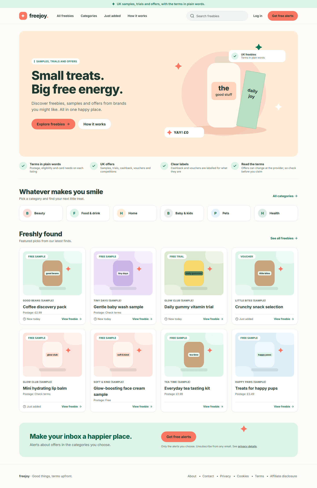
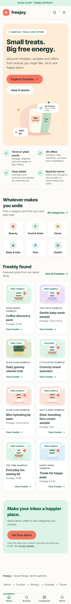
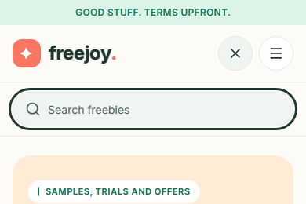
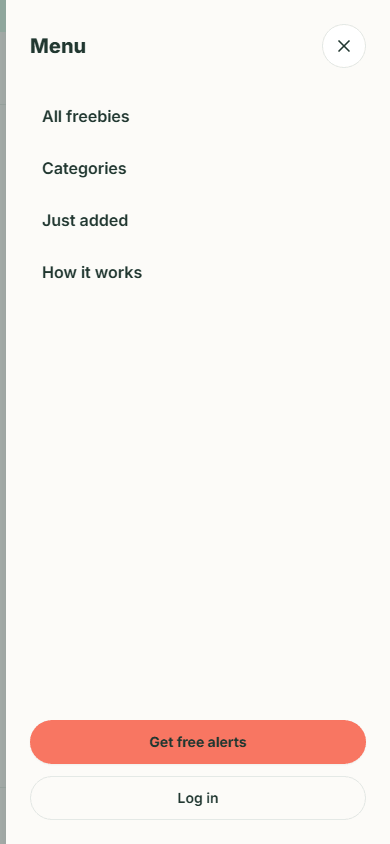

# 1. Home and finding your way around

[Back to the guide index](README.md)

Freejoy lists UK free samples, trials, cashback, vouchers and competitions, with the postage, eligibility and card
requirements shown before you click. You do not need an account to browse. (The brands in these screenshots are
sample data: see [the note in the index](README.md#the-data-in-the-screenshots-is-sample-data).)

## Step 1. Open the home page

1. Go to the Freejoy address in your browser. The home page opens.
2. Read it from the top:
   - The thin **mint strip** at the very top: "UK samples, trials and offers, with the terms in plain words."
   - The **header**: the freejoy logo, then **All freebies**, **Categories**, **Just added** and **How it works**,
     a **Search freebies** box, **Log in** and the coral **Get free alerts** button.
   - The **hero**: "Small treats. Big free energy." with two buttons, **Explore freebies** (opens the full list)
     and **How it works** (opens the About page at its "how it works" section).
   - The **trust strip** with four short promises, ending "Read the terms: Offers can change at the provider, so
     check before you claim".
   - **Whatever makes you smile**: one button for each category.
   - **Freshly found**: featured offers as cards, and a **See all freebies** link.
   - **Make your inbox a happier place**: a link to the [email alerts](04-email-alerts.md) sign-up.
   - The **footer**: About, Contact, Privacy, Cookies, Terms and Affiliate disclosure.

Desktop (1440 wide):

Phone (390 wide):

## Step 2. Use the header menu

| Menu item | Where it takes you |
| --- | --- |
| **All freebies** | The full list of offers ([page 2](02-browse-and-search.md)) |
| **Categories** | The full list, scrolled to the category choices |
| **Just added** | The full list sorted **Newest first** |
| **How it works** | The About page, "how it works" section |
| **Log in** | The sign-in page. You never need it to browse or to sign up for alerts |
| **Get free alerts** | The alerts sign-up form ([page 4](04-email-alerts.md)) |

The menu item for the page you are on is highlighted in mint.

## Step 3. Search from any page

1. Click **Search freebies** in the header (or the magnifying glass on a phone).
2. Type a word, for example `tea`, and press **Enter**.
3. You land on the catalogue with your word applied. See [page 2](02-browse-and-search.md#step-2-search).

## Step 4. On a phone: the menu, search and tab bar

On screens narrower than 1024 pixels the header shrinks to the logo plus two round buttons, and a **tab bar**
sits at the bottom of the screen.

1. Tap the **magnifying glass** to open the search box under the header. Tap the same button (now an X) to close it.

   

2. Tap the **menu** button (three lines) to open the **Menu** panel. It lists the four menu items, then **Get free
   alerts** and **Log in**. Tap the **X**, or tap outside the panel, to close it.

   

3. Use the **tab bar** at the bottom: **Home**, **Browse** (all freebies), **Categories** and **Alerts**. The tab
   for the page you are on is underlined and green.

## Step 5. Read a freebie card

Cards appear on the home page, in the catalogue, on category pages and under "You might also love" on offer pages.
Each card shows, from top to bottom:

1. A **type badge** on the picture: **Free sample**, **Free trial**, **Cashback**, **Voucher** or **Competition**.
   Cashback and vouchers are labelled for what they are, not as free items.
2. The **brand name** in small capitals (in the sample data: "Good Beans (Sample)").
3. The **offer title**.
4. For free samples only, a **Postage** line: "Postage: £2.99", "Postage: Free" or "Postage: Check terms".
5. A small clock label, **New today** or **Just added**, when the offer has one. These are labels an editor sets.
   Freejoy does not show urgency labels such as "Ending soon" or "Popular" on real offers.
6. **View freebie**, which opens the offer page ([page 3](03-offer-details.md)). The whole card is clickable.

## What you will not find

There are no saved or favourite offers, no visitor counts and no countdown timers. Browsing does not set cookies
or store anything in your browser (see [page 5](05-information-pages.md#what-freejoy-stores-in-your-browser)).
