# 2. Browse, search and filter

[Back to the guide index](README.md)

The catalogue lists every offer that is currently live. Everything you choose (search word, category, type,
postage, sort, page) is kept in the page address, so you can bookmark a view, share it, or press the browser's
**Back** button to undo a choice.

The sample catalogue in these screenshots has 21 live offers. (It was seeded with 24; one is a draft, one has
ended and one is archived, and those never appear here.)

## Step 1. Open the full list

1. Choose **All freebies** in the header (or **Browse** in the phone tab bar).
2. The page is headed "Find your next little treat." and says how many freebies are in the collection, for
   example "21 freebies in this collection".
3. Twelve cards show on each page. At the bottom a line reads "Showing 1–12 of 21".

Desktop: the filters sit in a panel on the left.

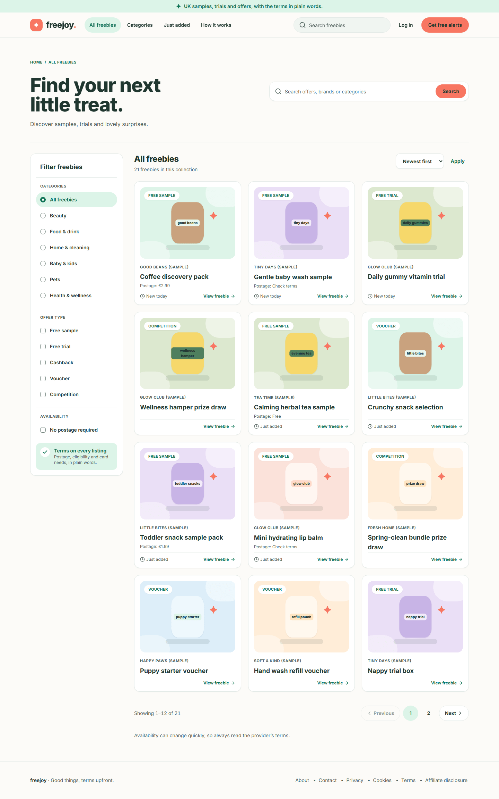

Phone: the category choices run along the top as buttons you can swipe sideways, and a **Filter** button opens the
other filters.

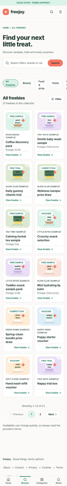

## Step 2. Search

1. Click the box that says "Search offers or brands" in the page heading (or use the search box in
   the header).
2. Type a word, for example `tea`.
3. Press **Enter** or click **Search**.
4. The list shrinks to the offers whose **title**, **summary** or **brand name** contains your word. The heading
   count updates.
5. Clear the box and search again to see everything.

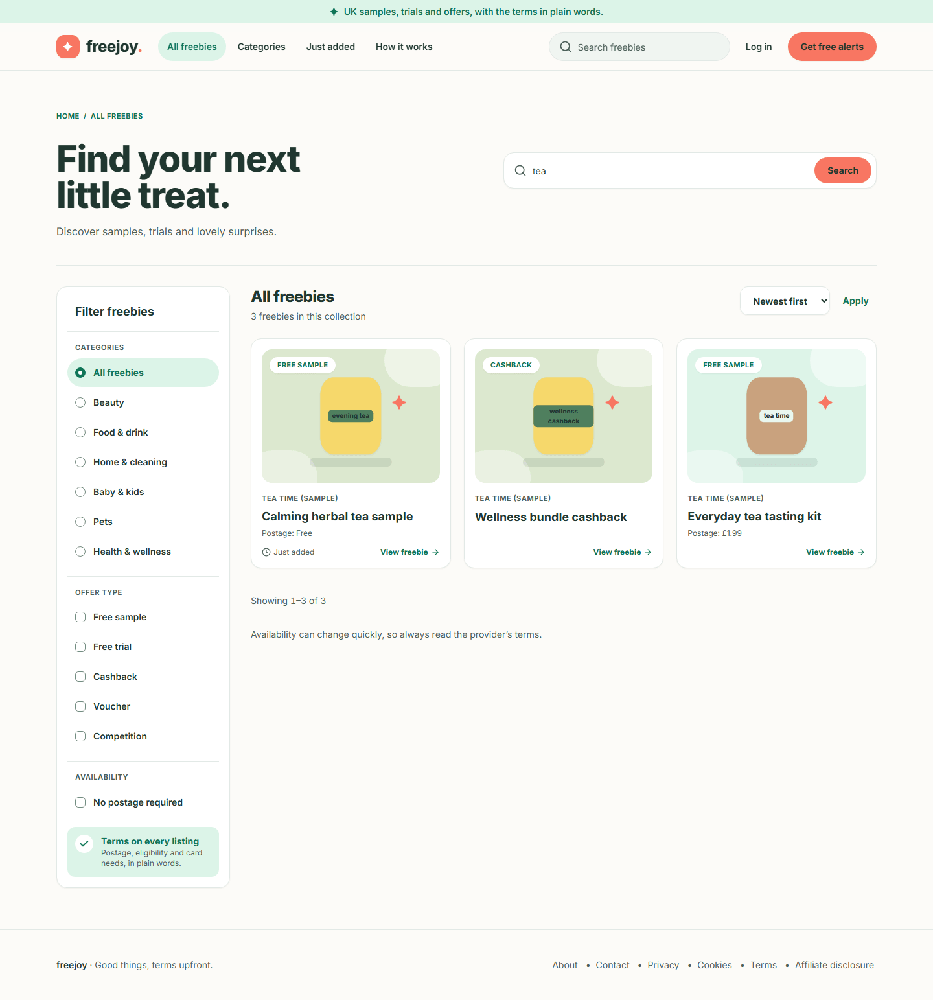

On a phone:

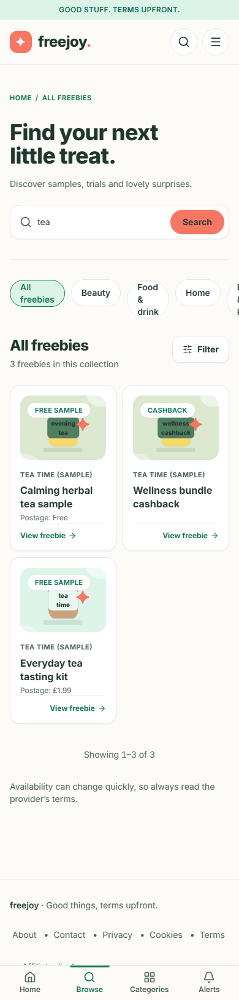

> **Privacy tip.** A search word travels in the page address, so it can stay in your browser history and in the
> web host's logs. Do not type an email address or any personal detail into the search box. The
> [privacy notice](05-information-pages.md) says the same.

## Step 3. Choose a category

1. On a desktop, click a name under **CATEGORIES** in the left panel: Beauty, Food & drink, Home & cleaning,
   Baby & kids, Pets or Health & wellness. On a phone, tap the matching button along the top.
2. The list shows only that category. The chosen name is highlighted and has a filled dot (a mark, not only a
   colour).
3. Choose **All freebies** to go back.

## Step 4. Choose an offer type

1. Under **OFFER TYPE** (desktop) or in the **Filter** drawer (phone), tick one or more of **Free sample**,
   **Free trial**, **Cashback**, **Voucher** and **Competition**.
2. Ticking several types **widens** the list: you see offers of any of the chosen types.
3. The type filter combines with the category and search. For example, Food & drink plus Free sample:

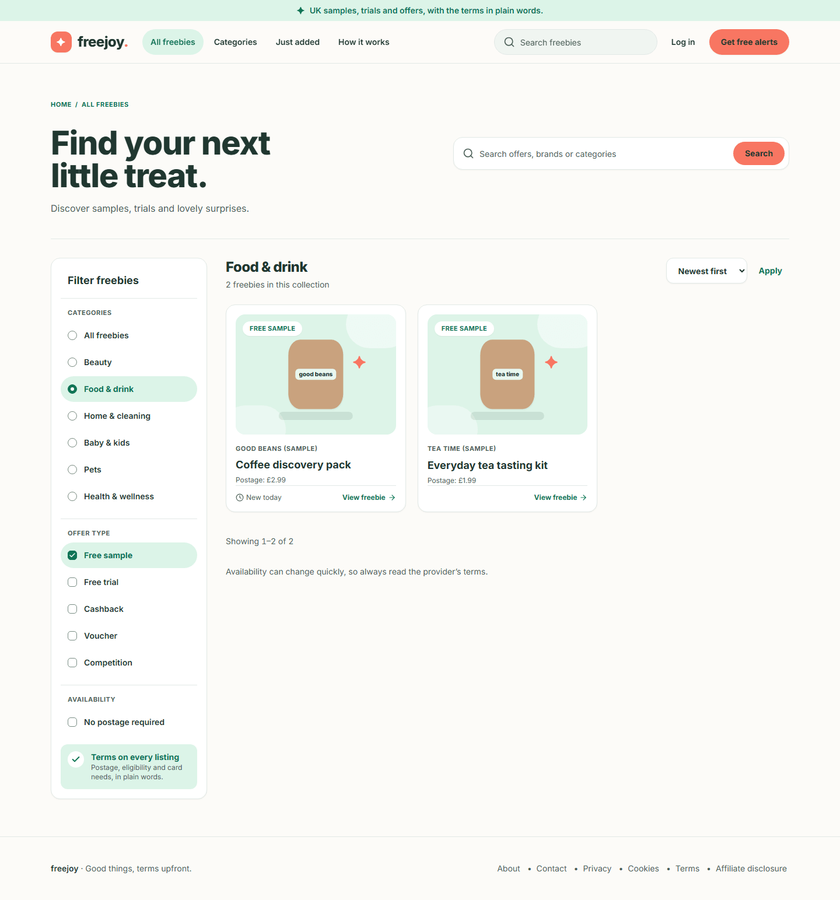

Phone:

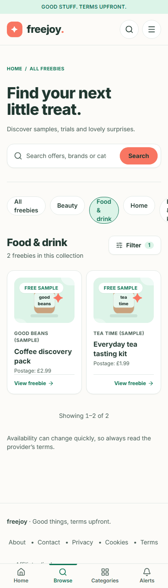

## Step 5. Show only offers with no postage

1. Under **AVAILABILITY** (or in the phone drawer) tick **No postage required**.
2. Only offers whose postage is listed as **free** remain. An offer whose postage says "Check terms" is not
   included, because Freejoy cannot say it is free.

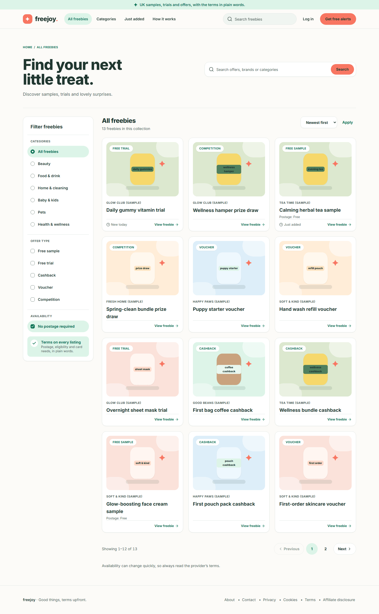

## Step 6. Sort the list

1. Above the cards, open the **Sort by** drop-down (it shows "Newest first").
2. Choose **Newest first**, **Ending soon** or **A to Z**.
3. Click **Apply**. The list does not change until you click **Apply**; this is deliberate so keyboard users can
   move through the choices without the page jumping.

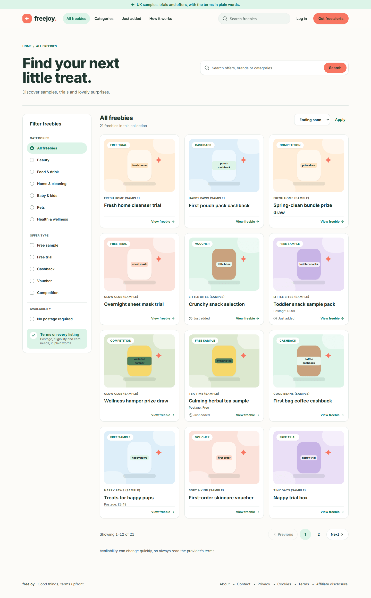

## Step 7. Move between pages

1. Scroll to the bottom of the list.
2. Click **Next**, **Previous** or a page number. The current page is highlighted. "Showing 13–21 of 21"
   style text tells you where you are.
3. Your filters stay applied on every page.

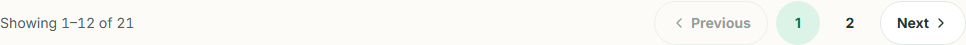

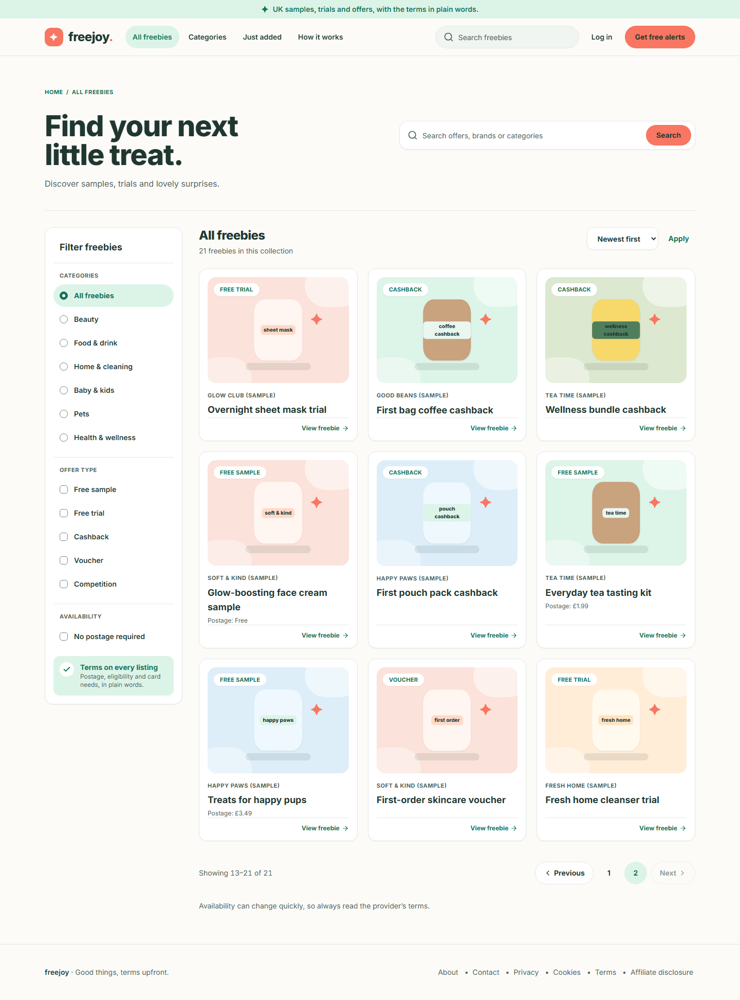

## Step 8. When nothing matches

If your search and filters match nothing, the list is replaced by a panel headed **No freebies match that yet**. It
repeats your search word, then offers:

- **Clear filters** (removes everything and shows the full list), and
- a row of category buttons under "Or browse a category".

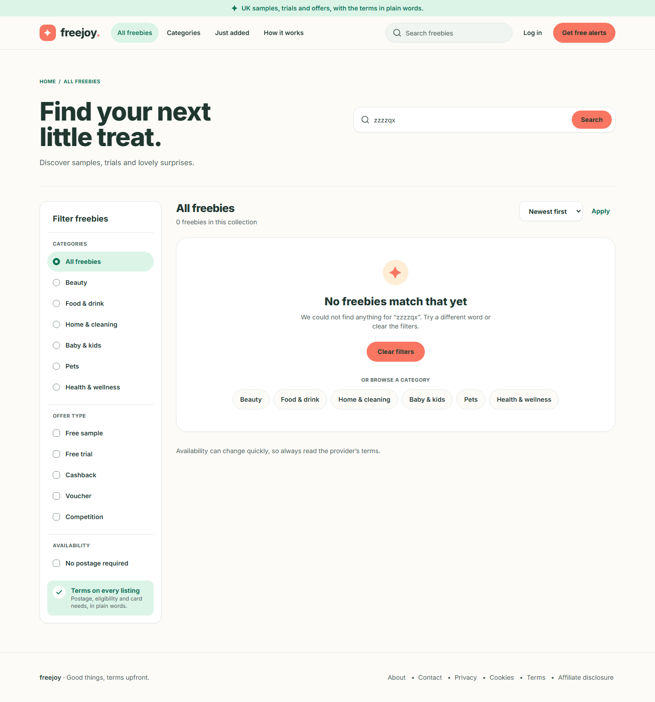

Phone:

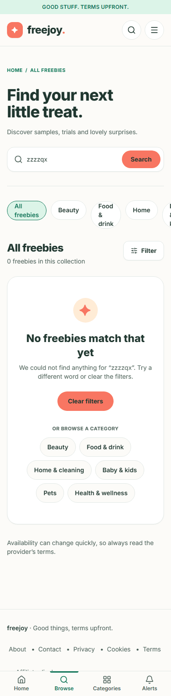

## Step 9. When the catalogue cannot be loaded

Rarely, the site cannot reach its catalogue. Instead of the list you see a panel headed **The freebies are not
loading** with the message "We could not load the freebies just now. Please try again in a moment." and a **Try
again** button. Click it, or wait a moment and reload. The page still works; only the list is missing.

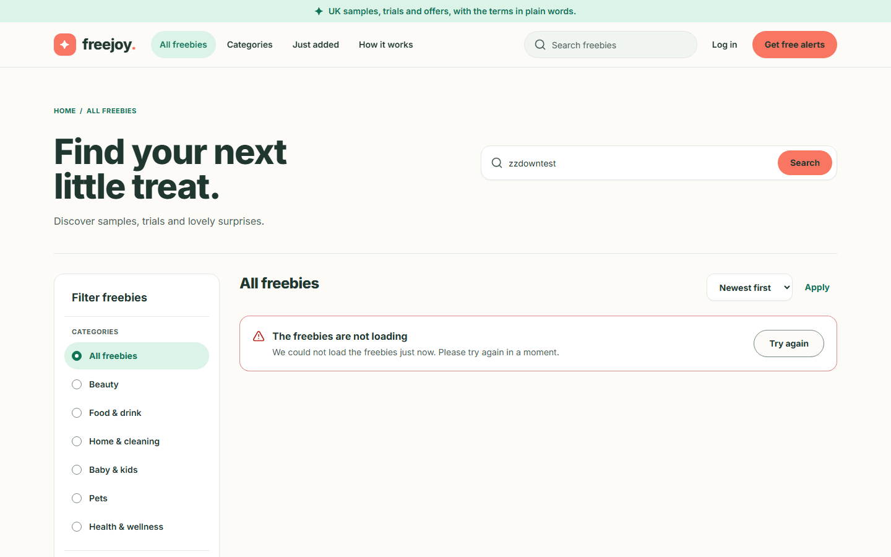

Phone:

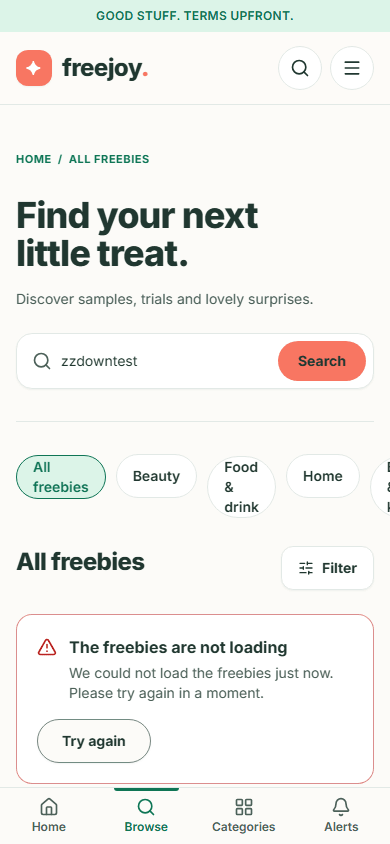

## Step 10. The phone filter drawer

1. On a phone, tap **Filter** (next to the heading count).
2. A panel slides up with **Offer type**, **Availability** (No postage required) and **Sort by**, plus a **Clear
   filters** button. Tap a choice to apply it.
3. Close the drawer with the **X** (or the Escape key on a keyboard). The category buttons stay on the page behind
   it rather than inside the drawer.

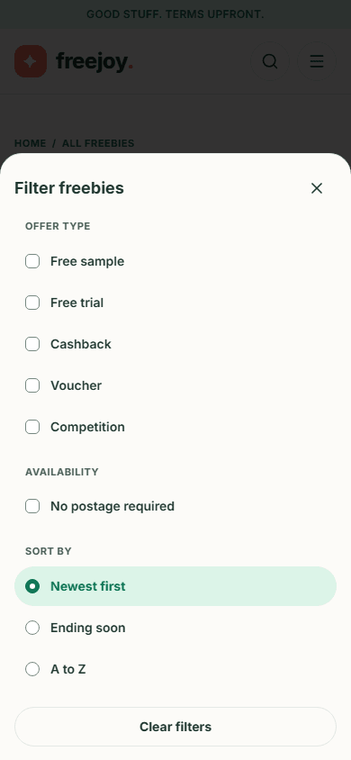

The drawer needs JavaScript. Search, sort (with **Apply**), the category buttons and the page links work without it.

## Step 11. Category pages

Each category also has its own page, for example `/category/food-drink`. Reach it from the home page's **Whatever
makes you smile** buttons, or from a breadcrumb on an offer page.

1. The page opens with a heading such as "Food & drink freebies", a short introduction and the count, such as
   "4 freebies in this category".
2. The same type, postage and sort controls are there. Instead of the category list the panel says "You are
   browsing one category." with a **Switch category** link.

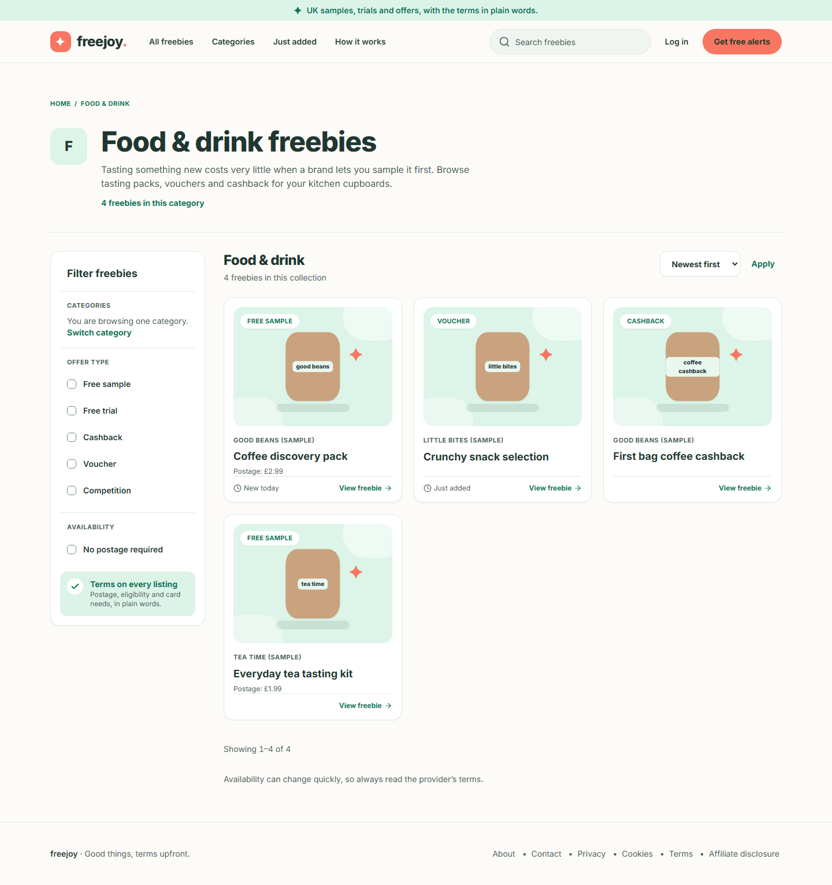

Phone:

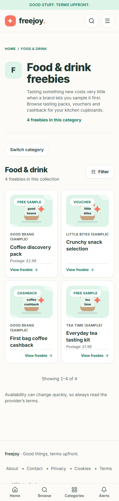

If a category does not exist, or an admin has disabled it, you get the [404 page](05-information-pages.md#the-page-not-found-page).
