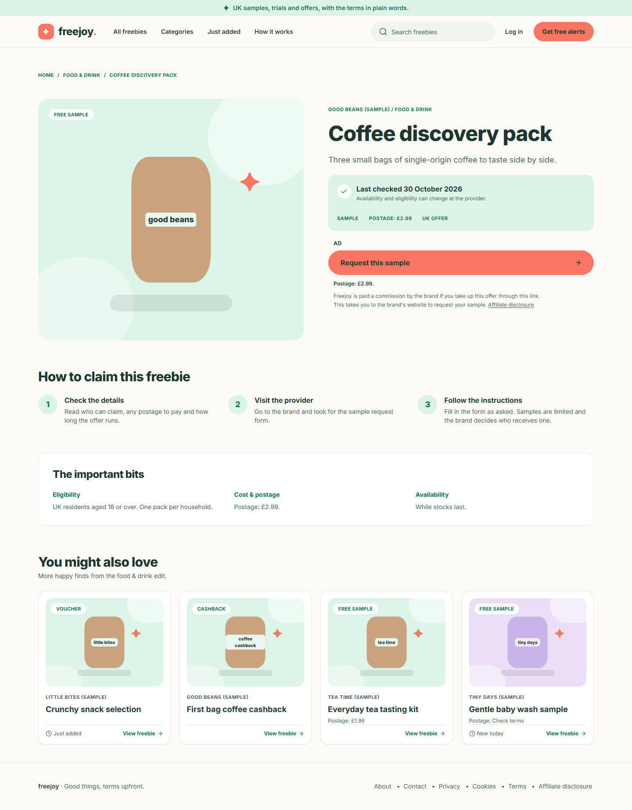
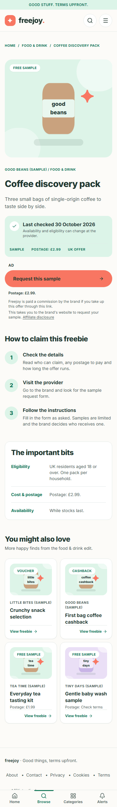
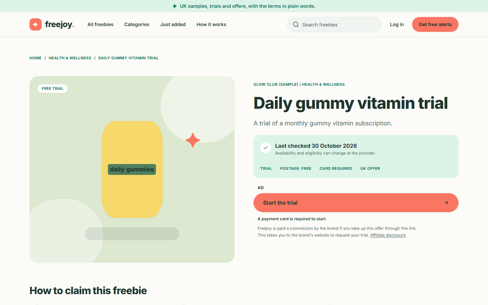
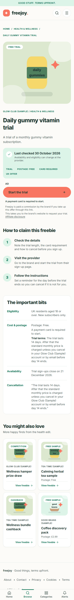
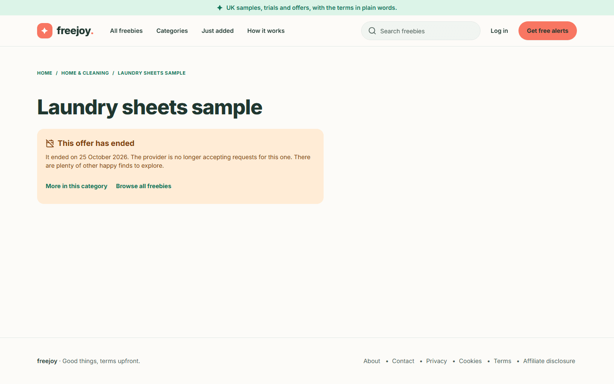
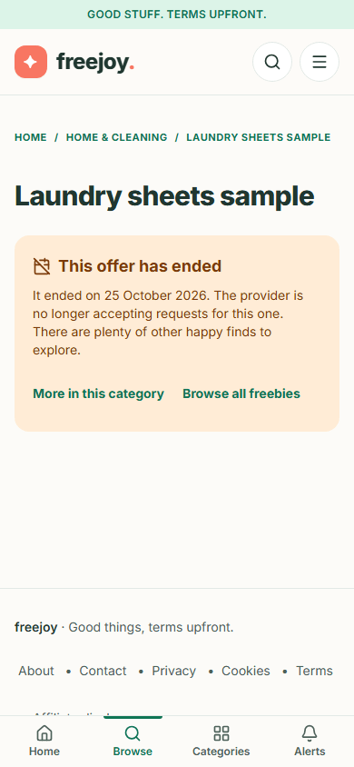

# 3. Reading an offer

[Back to the guide index](README.md)

Every offer has its own page. This page is built so you can see the conditions **before** you leave Freejoy.
(In the screenshots the brand is "Good Beans (Sample)" and the dates are sample dates: see
[the note in the index](README.md#the-data-in-the-screenshots-is-sample-data).)

## Step 1. Open an offer

1. Click any card, or its **View freebie** link, on the home page, the catalogue or a category page.
2. The address looks like `/freebies/coffee-discovery-pack`.

## Step 2. Read the top of the page

From the top:

1. **Breadcrumbs**: "Home / Food & drink / Coffee discovery pack". Each part except the last is a link back.
2. **The picture and type badge**. The picture is an illustration, not a photograph of the product.
3. **Brand and category**, then the **title** and a one-line **summary**.
4. **The checks panel** (the mint box). This is the most important part:
   - **Last checked** and a date, for example "Last checked 30 October 2026", with the sentence "Availability and
     eligibility can change at the provider." The date is the day an editor last confirmed the offer. If it is
     not recent, check the brand's own page before you claim.
   - A row of capital-letter facts: the kind of offer (**SAMPLE**, **TRIAL**, **CASHBACK**, **VOUCHER** or
     **COMPETITION**), **POSTAGE: £2.99** (or **FREE**, or **CHECK TERMS**), **CARD REQUIRED** when you must
     enter a payment card, and **UK OFFER**.
5. **The claim area**: see Step 3.

On a phone the same content is stacked in one column:

## Step 3. Understand the claim button and the "Ad" label

1. Above the coral button you see the word **AD**. It tells you this link is an affiliate link: the brand pays
   Freejoy if you take up the offer through it.
2. The button is named for the kind of offer: **Request this sample**, **Start the trial**, **Get this cashback**,
   **Get this voucher** or **Enter this competition**.
3. Directly below the button is a line of conditions that travels with it:
   - for a free sample, "Postage: £2.99." (or "Postage: free." or "Postage: check the brand's terms.");
   - for a free trial that needs a card, "A payment card is required to start."
4. Under that, in smaller type: "Freejoy is paid a commission by the brand if you take up this offer through this
   link." and "This takes you to the brand's website to request your sample." with a link to the
   **Affiliate disclosure** page ([page 5](05-information-pages.md)).

A trial that needs a card looks like this:

Phone:

## Step 4. Read how to claim

Under the top section, **How to claim this freebie** lists numbered steps written by the editor, for example
"Check the details", "Visit the provider", "Follow the instructions". Read step 1 first: it tells you what to
look for before you start (postage to pay, trial length, how to cancel).

## Step 5. Read "The important bits"

This box is your checklist. It always has:

- **Eligibility**: who can claim ("UK residents aged 18 or over. One pack per household.").
- **Cost & postage**: the postage again, and for trials that need a card, "A payment card is required to start."
- **Availability**: how long the offer runs or when sign-ups close ("While stocks last.", "Trial sign-ups close on
  21 December 2026.").

For a free trial there are also **Trial terms** (how long it lasts and what is charged afterwards) and a
**Cancellation** quote repeating them. Read these before you give card details to the brand.

## Step 6. Look at "You might also love"

The last block shows up to four more offers from the same category. Use it to keep browsing.

## Step 7. Claim the offer

1. Click the coral button.
2. Your browser goes to a Freejoy address that starts with `/go/` and is **immediately** sent on to the brand's
   own website. You will not see the `/go/` page; it only counts the click and passes you on.
3. You are now on the brand's site. Complete the claim there. **Freejoy does not collect your claim details**, and
   Freejoy cannot change what the brand decides.
4. Press **Back** in your browser to return to Freejoy.

What the click counts: which offer, the time to the nearest minute, the name of the website you came from (not the
page) and a rough device type (desktop, mobile, tablet or automated). It does not store your IP address, set a
cookie or store any identifier for you. The brand's website, or the affiliate network that tracks the click, handle
your visit under their own policies and may set cookies of their own.

> **No screenshot for this step.** After the click you are on another company's website, which is not part of
> Freejoy. In the test setup used for this guide, the browser was also prevented from reaching any outside site,
> and the sample destination is a placeholder on `example.com`.

## Step 8. What happens when an offer has ended

An offer that was live and has since ended is not removed straight away. For up to 30 days after its end date, its
page says so instead of showing the claim button:

1. The headline is the offer title.
2. A panel reads **This offer has ended** with "It ended on 25 October 2026. The provider is no longer accepting
   requests for this one. There are plenty of other happy finds to explore."
3. Two links take you on: **More in this category** and **Browse all freebies**. There is no claim button, no
   steps and no terms.

Phone:

After those 30 days the page becomes a normal [404 "page not found"](05-information-pages.md#the-page-not-found-page).
The same happens straight away for an offer that was never published or has been unpublished or archived.

### If you click a saved or old claim link

If you had saved or bookmarked a claim link (`/go/...`) for an offer that has since ended, Freejoy does not send you
to the brand. It sends you to the ended page above:

Phone:

For an offer that is not public at all (a draft, archived or unknown), the claim link shows a plain page with the
words "This offer is not available." If you open claim links many times in a short while the site answers "Too many
requests. Please try again shortly."; wait a minute and try again. If the site cannot reach its data you may see "This link is not available right now. Please try again later."
