# 4. Email alerts

[Back to the guide index](README.md)

You can ask Freejoy to email you about new freebies in the categories you pick. Freejoy uses a **double opt-in**:
nothing starts until you open a link in an email and press a button. You never need an account.

> **Status today.** The sign-up form, the confirmation email, confirming and unsubscribing all work. The site only
> sends the **confirmation** email so far; regular alert emails are not built yet. Until the owner switches the form
> on, the site shows "Alerts aren't open yet" (Step 0).

## Step 0. If alerts are not open yet

When the form is switched off, the page shows a notice instead of the form: **Alerts aren't open yet.** "Nothing you
could enter here would be sent or saved, so the sign-up form is switched off until alerts launch." Use **Browse
freebies** to carry on.

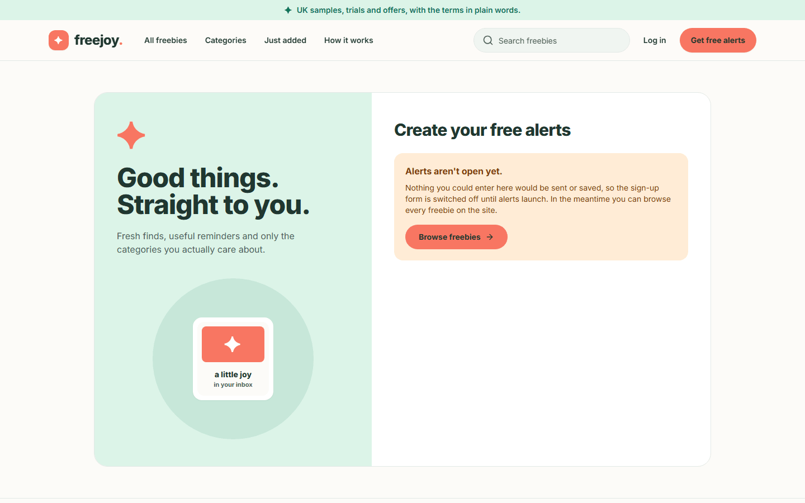

Phone:

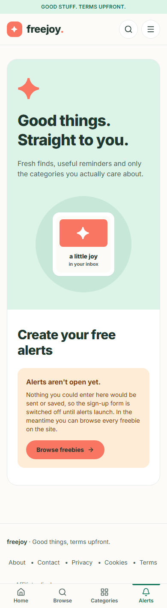

## Step 1. Open the sign-up page

1. Click **Get free alerts** in the header, the **Alerts** tab on a phone, or the button in the home page's
   "Make your inbox a happier place" band.
2. The page "Create your free alerts" opens. (Nothing is typed into the address bar for you: Freejoy never puts an
   email address in a page address.)

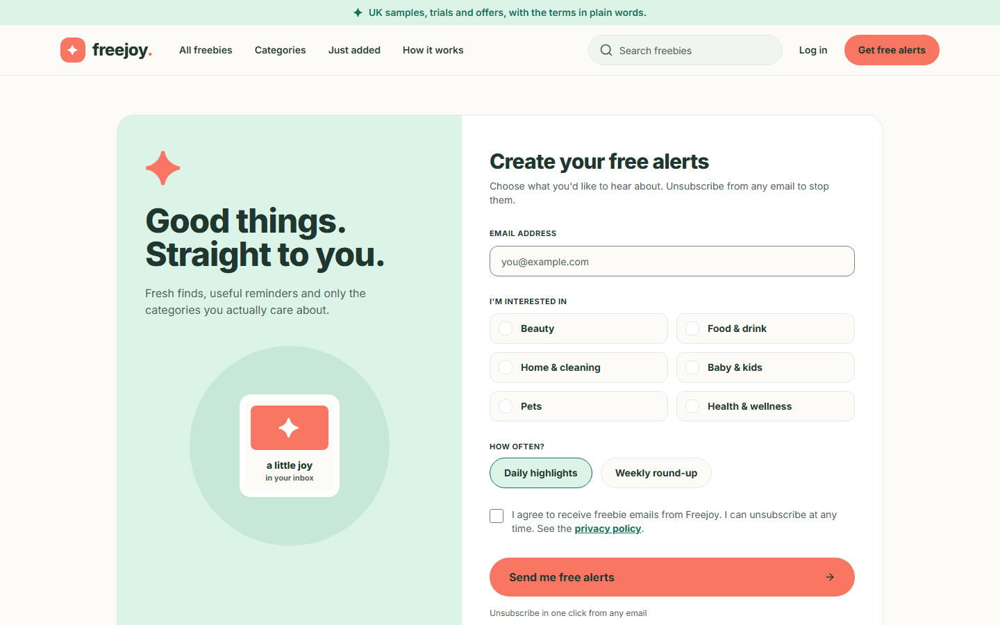

Phone:

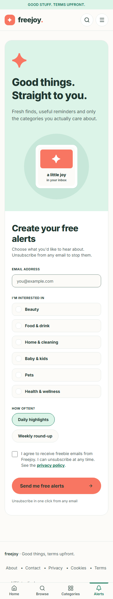

## Step 2. Fill in the form

1. **Email address**: type the address you want alerts sent to.
2. **I'm interested in**: tick one or more categories (Beauty, Food & drink, Home & cleaning, Baby & kids, Pets,
   Health & wellness). You must pick at least one.
3. **How often?**: choose **Daily highlights** or **Weekly round-up**. One is always selected; **Daily highlights**
   is selected to begin with.
4. Tick **I agree to receive freebie emails from Freejoy. I can unsubscribe at any time.** The words "privacy
   policy" link to the (draft) [privacy notice](05-information-pages.md).

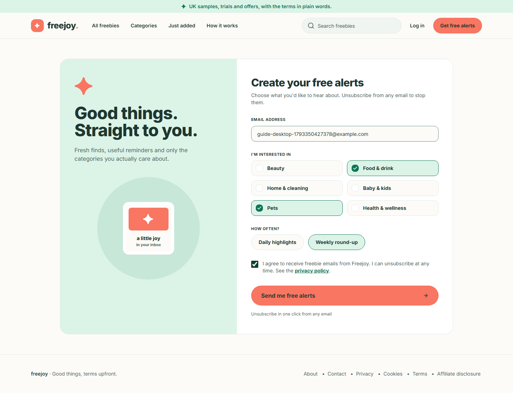

Phone:

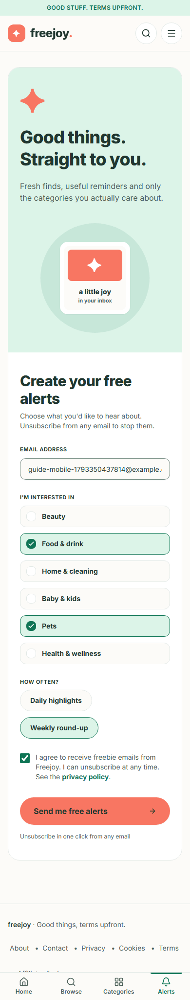

## Step 3. If something is missing

Press **Send me free alerts** with the form incomplete and each problem is written next to the field, and the first
problem field is focused:

- "Enter your email address." (or "Enter a valid email address.")
- "Choose at least one category."
- "Please agree to receive emails to continue."

Fix them and press the button again.

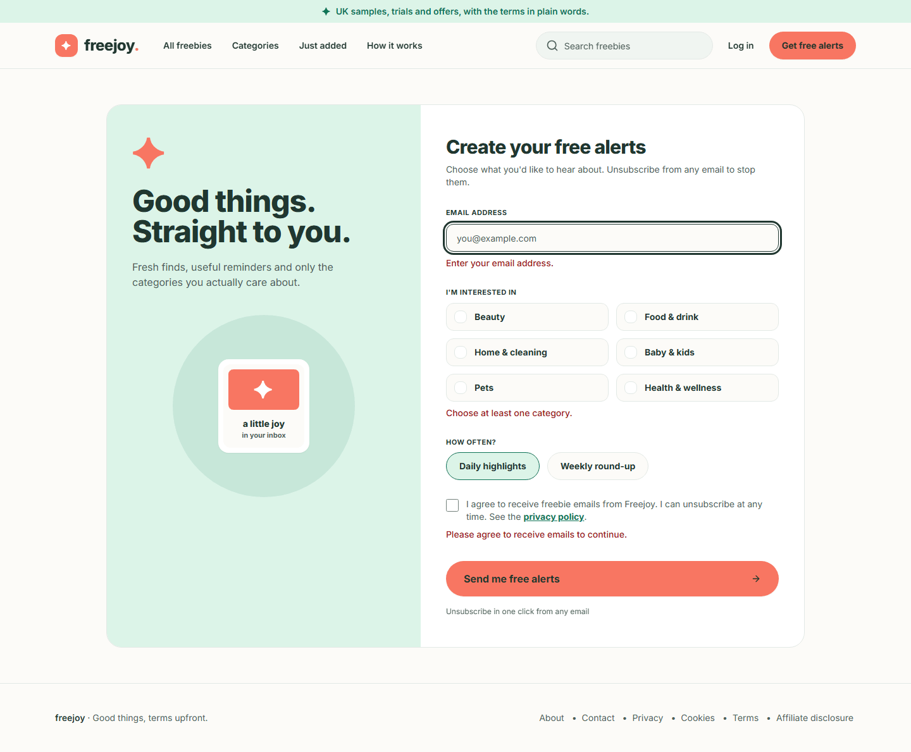

Phone:

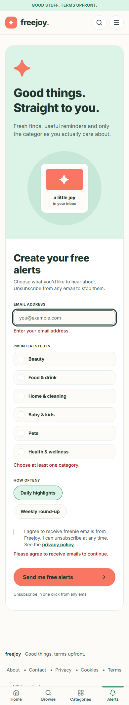

## Step 4. Send the form

1. Press **Send me free alerts**. The button says "Sending..." for a moment.
2. A green panel headed **Check your inbox** replaces the button: "If *your address* is new to our alerts, we have
   sent it a confirmation link. Open the link within 24 hours to start your alerts: nothing starts until you do. If
   you do not see it in a few minutes, check your spam folder. If it has not arrived after a few minutes, you can
   submit the form again. If you are already signed up, there is nothing more to do."
3. Two links offer **Browse freebies** and **Use a different address**.

The same message appears for every address, whether it is new, waiting, already confirmed or previously
unsubscribed. This is deliberate: nobody can use the form to find out whether someone else's address is on the list.

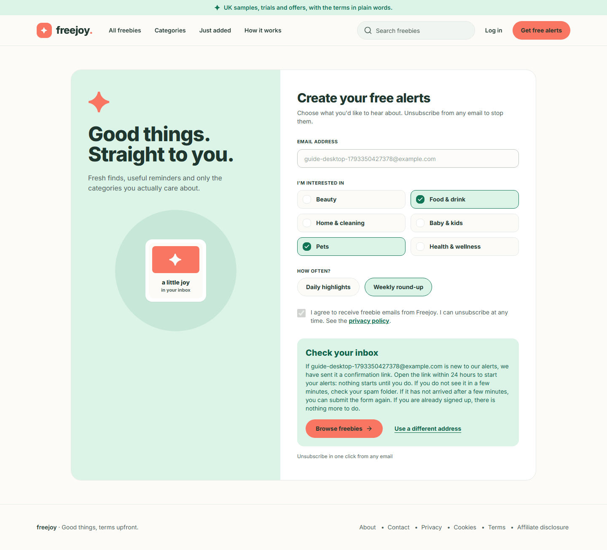

Phone:

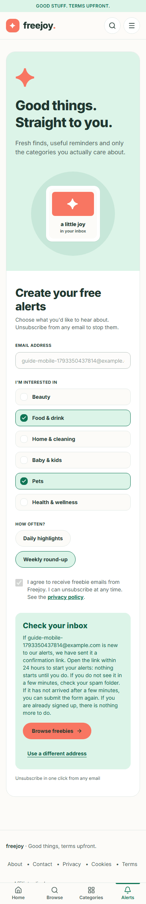

## Step 5. Open the confirmation email

The email is sent a moment after you press the button. In the test used for this guide the email provider was a
"fake" one that writes each email to a file, so there is no inbox screenshot. This is the text of the email that was
captured (the two long codes are shortened to `<code>` and the local test address is replaced by `<freejoy address>`; real
links carry one-use codes):

```text
Subject: Confirm your Freejoy alerts

Hello,

Someone, hopefully you, asked for Freejoy alerts using this email address.

To confirm, open this link within 24 hours:
https://<freejoy address>/alerts/confirm?token=<code>

If this was not you, do nothing: you will not be added to the list. To make sure we never email this address, use
this link instead:
https://<freejoy address>/alerts/unsubscribe?token=<code>

Freejoy
```

The email also carries the
standard "unsubscribe" header, so many mail apps show their own **Unsubscribe** button.

If it never arrives, look in your spam folder, then submit the form again. If the same address is waiting for
confirmation, Freejoy re-sends the link (at most about once an hour).

## Step 6. Confirm

1. Open the **confirm** link from the email.
2. The page "Confirm your free alerts" says "One last step. Press the button to start your alerts. The link in your
   email works for 24 hours." Opening the link alone changes nothing, so mail-scanning software cannot confirm for you.
3. Press **Confirm my alerts**.
4. The page changes to **You are signed up**: "Thank you. Your alerts are confirmed, and every email has an
   unsubscribe link." with a **Browse freebies** link.

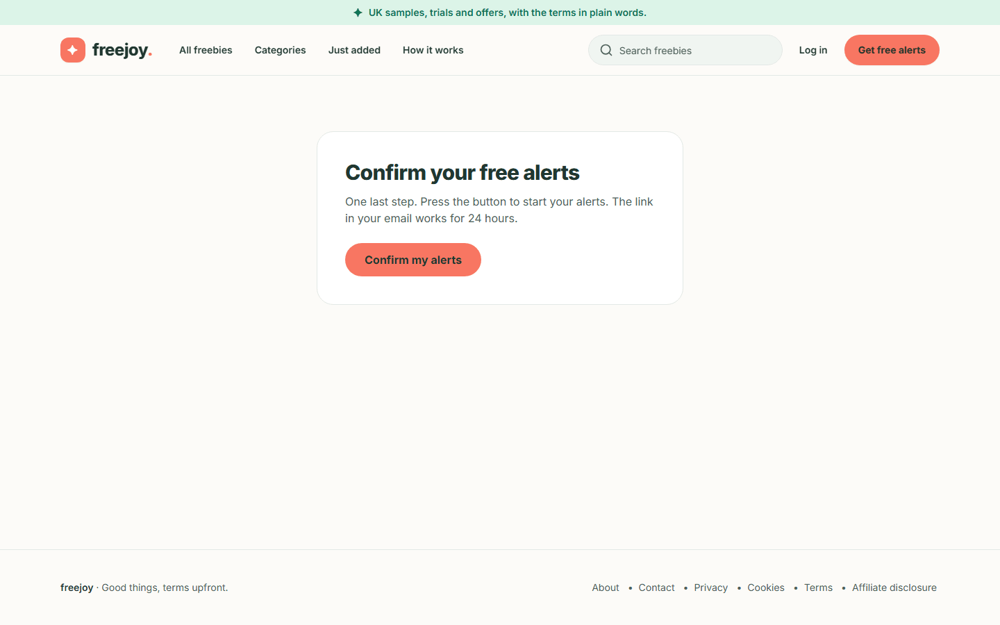

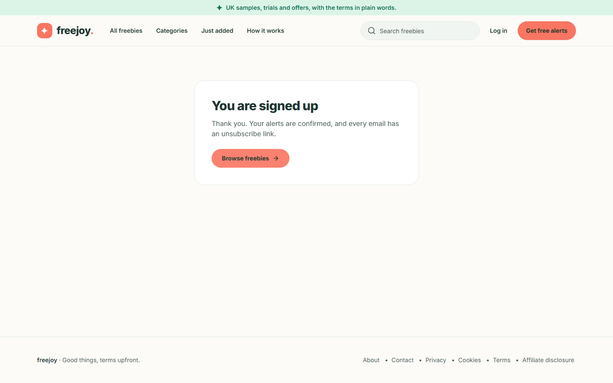

Phone:

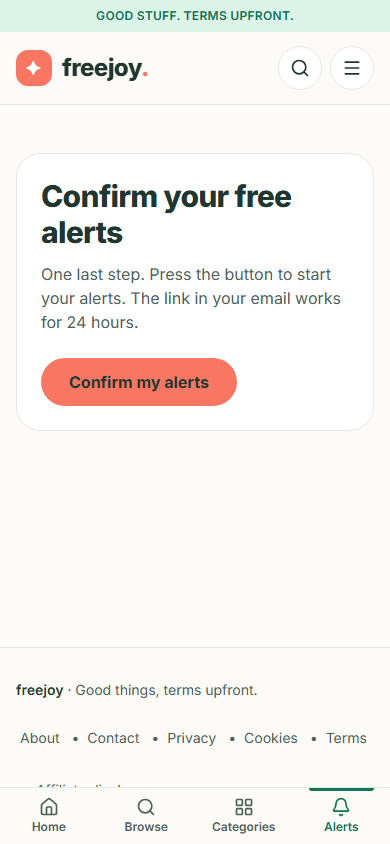

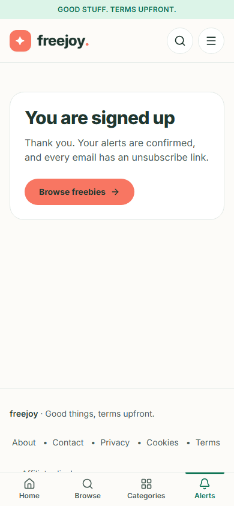

If the link is too old, already used, or was cut off when you copied it, the page says "This link is not valid any
more. It may have expired or already been used. You can start again from the alerts page." (or "This link is
incomplete. Please use the link in your email, or start again from the alerts page." when the code is missing). Use
**Back to alerts** to start again.

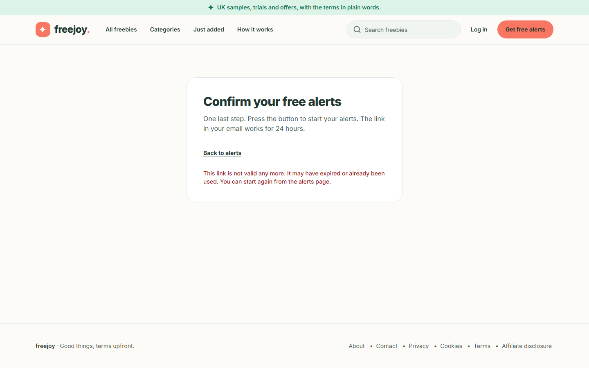

Phone:

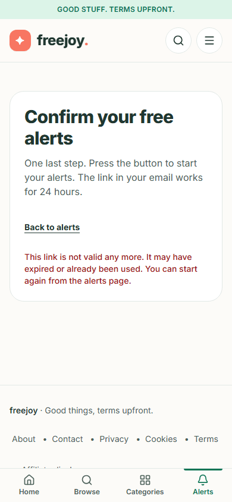

## Step 7. Changing your categories or how often

There is **no preferences page** yet. Your categories and frequency are the ones you chose on the form.

- Before you confirm, submitting the form again with the same address (once about an hour has passed, because
  Freejoy limits how often it re-sends the link) updates your categories and frequency and sends a new link.
- After you confirm, submitting the form again changes nothing (anyone could type your address, so the form is not
  allowed to alter a confirmed subscriber).
- If you want something different, you currently have to unsubscribe (Step 8). Note that an unsubscribed address
  cannot sign up again through the form; see "Things to know" below.

## Step 8. Unsubscribe

You can unsubscribe from any email, in one step, with no login.

1. Open the **unsubscribe** link in the email (or use your mail app's **Unsubscribe** button, which does the same
   thing without opening a page).
2. The page "Unsubscribe from Freejoy alerts" says "Press the button and we will stop sending you alerts."
3. Press the button.
4. The page says **You are unsubscribed**: "We will not send you any more alerts. We keep your address on a
   do-not-email list for 12 months so it is not emailed again, then delete it." (**Back to Freejoy** returns to the
   home page.)

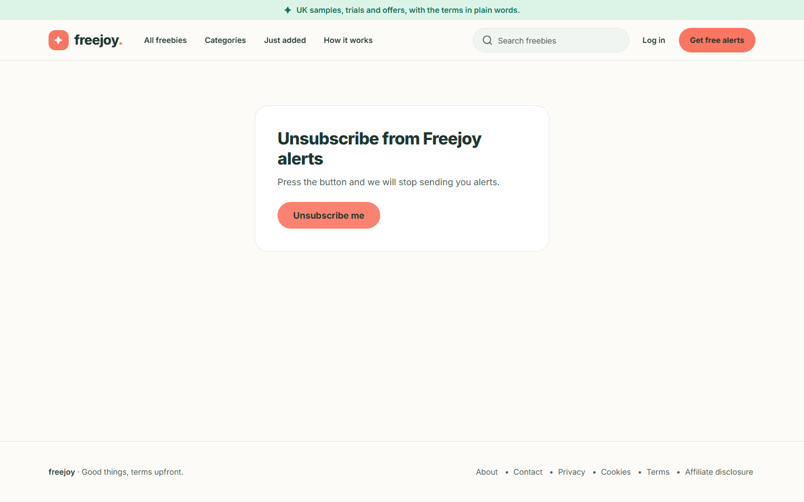

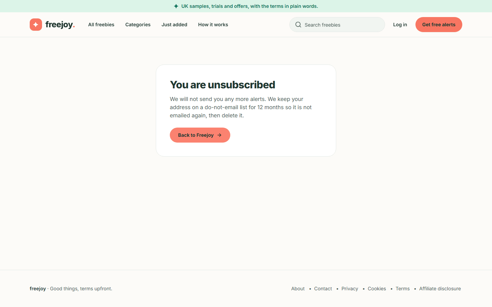

Phone:

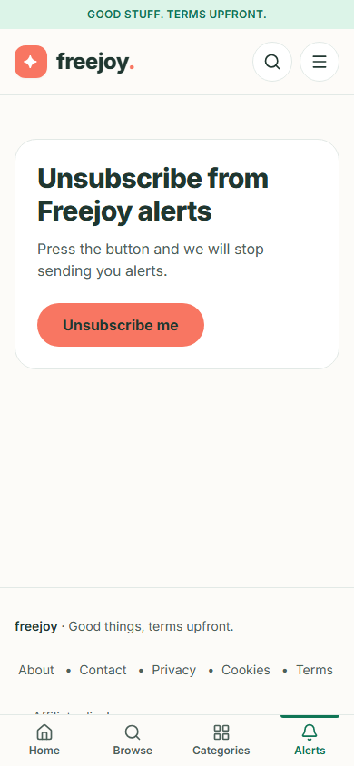

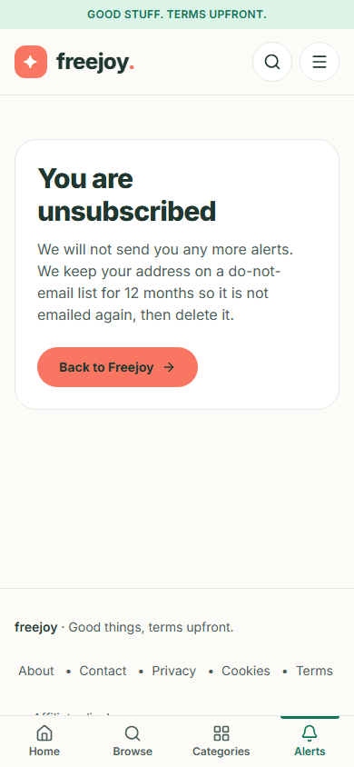

## Things to know

- A sign-up that is never confirmed is deleted after 30 days (a maintenance command run by the operator).
- An address you unsubscribed stays on a do-not-email list for 12 months. During that time the sign-up form
  accepts the address but sends nothing, to protect you from someone else re-adding it. Bringing it back is
  currently something the site operator does by hand.
- Freejoy stores your address, your categories and frequency, and a record of your consent (the wording you saw, when
  you agreed and which form). It does not store your IP address in that record. See the draft
  [privacy notice](05-information-pages.md) for the details, which are pending legal review.
- Freejoy limits how often one address, and one network, can use the form, so a very quick run of attempts may be
  slowed down.
