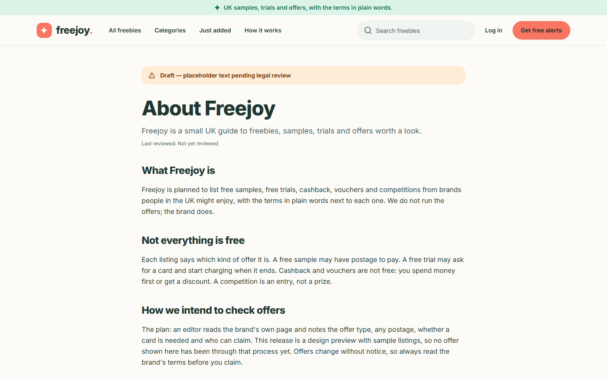
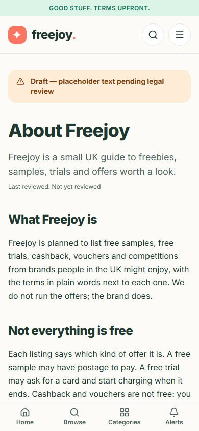
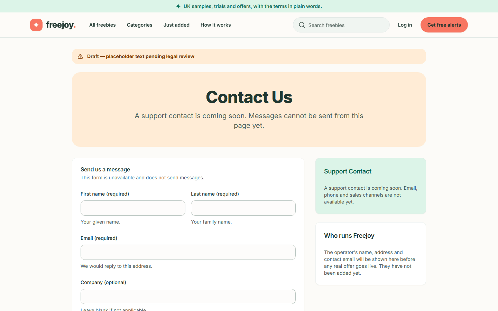
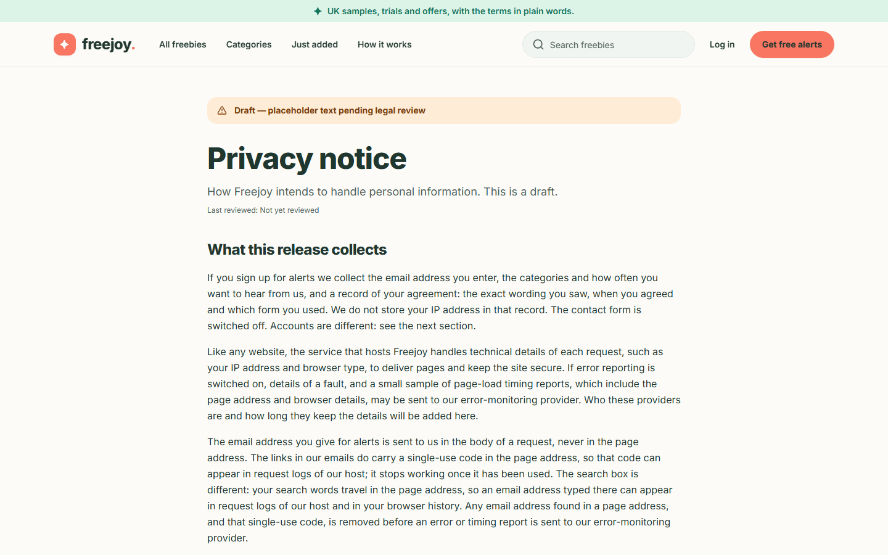
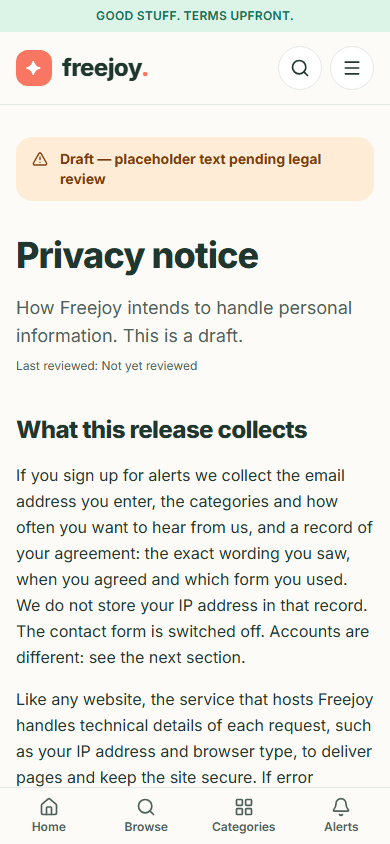
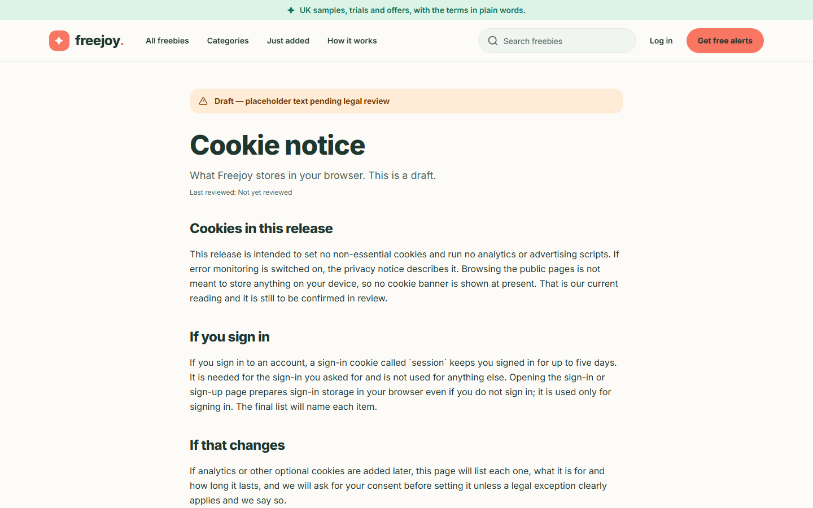
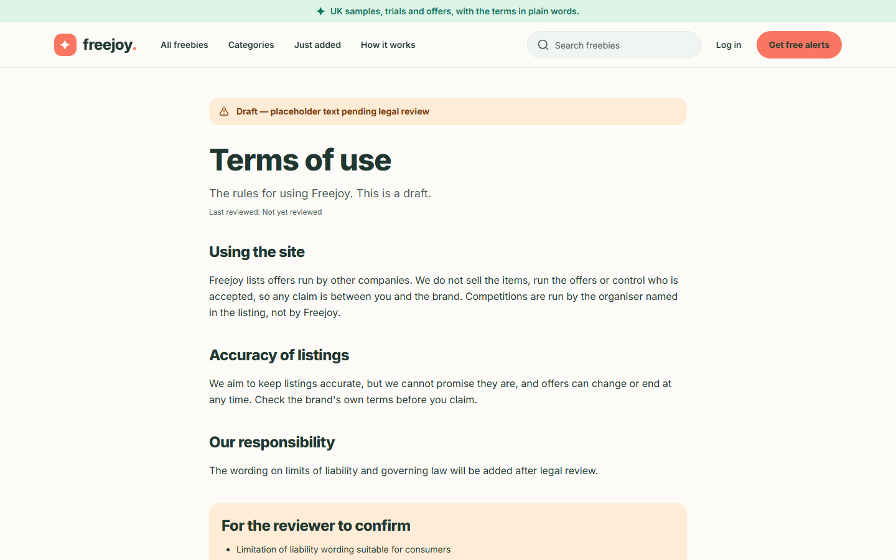
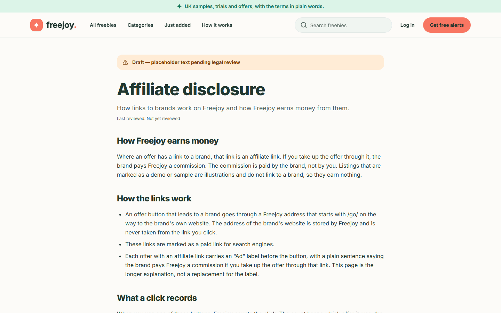
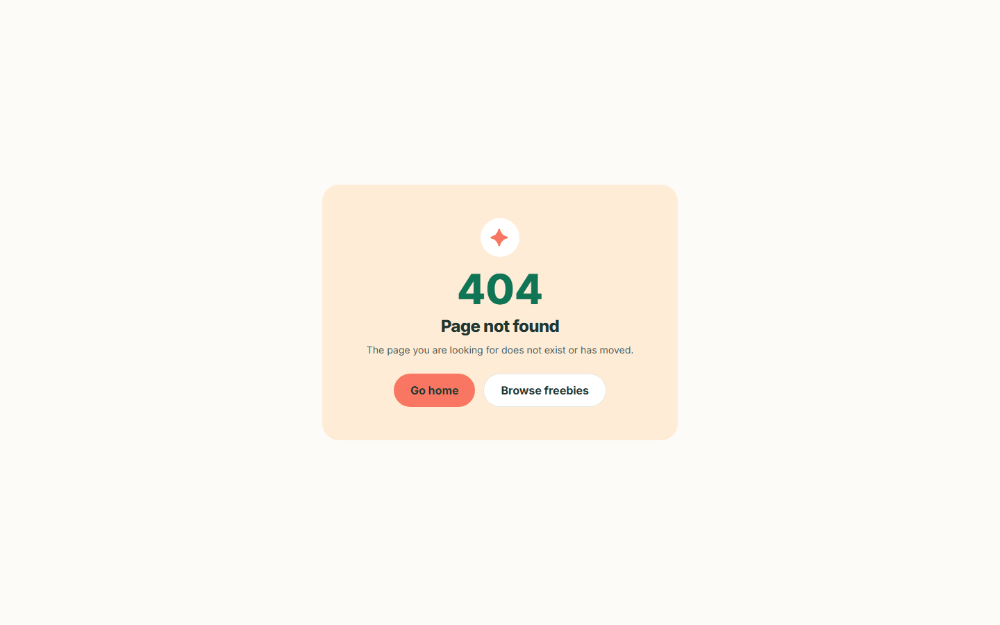
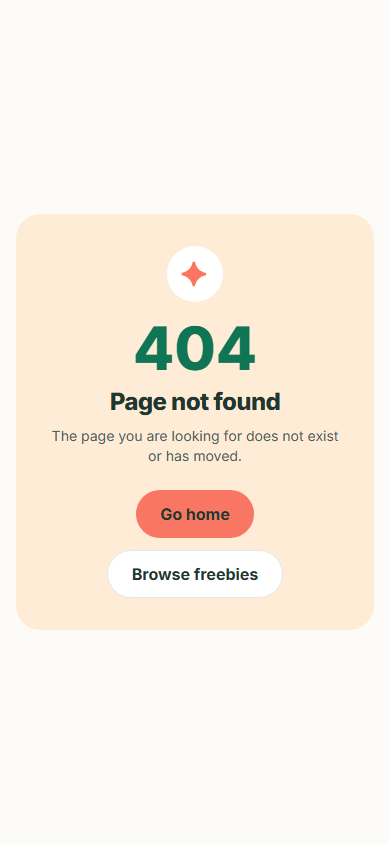

# 5. About, contact, legal pages, 404 and cookies

[Back to the guide index](README.md)

> **Every page described in this section except the 404 page is a draft.** Each shows a banner at the top reading
> **"Draft — placeholder text pending legal review"**, and the About, Privacy, Cookie, Terms and Affiliate disclosure
> pages also say **"Last reviewed: Not yet reviewed"**. Each, except Contact, ends with a **"For the reviewer to confirm"**
> checklist of open questions for the person who will review it. The wording is a placeholder and is not legal advice. The
> pages are also asked not to be indexed by search engines.

## Step 1. Find the pages

1. Scroll to the bottom of any page. The footer links to **About**, **Contact**, **Privacy**, **Cookies**,
   **Terms** and **Affiliate disclosure**.
2. Click the one you want. On a phone the footer links wrap onto more than one line.

## Step 2. About

The About page ("About Freejoy") explains in plain words:

- **What Freejoy is**: a UK guide to free samples, trials, cashback, vouchers and competitions. Freejoy does not run
  the offers; the brand does.
- **Not everything is free**: a free sample may have postage; a free trial may ask for a card and start charging;
  cashback and vouchers are not free; a competition is an entry, not a prize.
- **How we intend to check offers** and **How it works** (the page the header's **How it works** link jumps to):
  find something, read the terms first, claim it on the brand's site.
- **How Freejoy plans to pay for itself**: commission on some links, with a link to the affiliate disclosure.
- **Keeping in touch**.

Phone:

> **Two paragraphs change with the site's settings.** "Keeping in touch" says you can sign up for email alerts when
> alerts are switched on, and says alerts are not open yet when they are off. "How we intend to check offers" adds a
> sentence calling the site a "design preview with sample listings" only while it shows sample listings, not real
> offers. The screenshots above were taken before this wording was corrected, so those two paragraphs read
> differently in them. The page is still a draft and its text still needs legal review.

## Step 3. Contact

1. Open **Contact**. It says "A support contact is coming soon. Messages cannot be sent from this page yet."
2. You will see a form (First name, Last name, Email, Company, Subject, Message), but it is **switched off**: it is
   labelled "This form is unavailable and does not send messages", and the **Send message** button says "Message
   sending is coming soon."
3. A **Support Contact** note says email, phone and sales channels are not available yet, and **Who runs Freejoy**
   says the operator's name, address and contact email will be added before any real offer goes live.

## Step 4. Privacy notice

The **Privacy notice** says what Freejoy collects, in sections: **What this release collects**, **If you create an
account**, **Email alerts**, **If you use an offer button** and **Your rights**. Key points it makes today:

- If you sign up for alerts: your email address, your categories and how often, and a record of your agreement. Your
  IP address is not stored in that record.
- A search word travels in the page address, so an email address typed into the search box can appear in server logs
  and your browser history. Do not type one there.
- The links in alert emails carry a single-use code that stops working once used.
- Using an offer button counts a click without identifying you (see [page 3](03-offer-details.md#step-7-claim-the-offer)).

Phone:

## Step 5. Cookie notice, Terms and Affiliate disclosure

- **Cookie notice**: see [What Freejoy stores in your browser](#what-freejoy-stores-in-your-browser) below.
- **Terms of use**: **Using the site**, **Accuracy of listings** (offers change at the brand, so check before you
  claim) and **Our responsibility**.
- **Affiliate disclosure**: **How Freejoy earns money** (a commission, paid by the brand, never by you), **How the
  links work** (offer buttons go through a Freejoy address starting `/go/`, and are marked as paid links for
  search engines), **What a click records**, **What we aim to keep separate** (commission should not change the terms
  shown) and **Paid placements** (none planned; they would be labelled as ads).

## The "page not found" page

If you follow a wrong or old address, for example a mistyped offer name, an offer that was never published, an
offer that ended more than 30 days ago, or a category that does not exist, you see a calm panel with a large **404**,
the heading **Page not found** and the words "The page you are looking for does not exist or has moved." Two buttons
help: **Go home** and **Browse freebies**. The page also tells search engines it is a genuine "not found".

Phone:

## What Freejoy stores in your browser

**No cookie banner is shown**, and that is deliberate: while you only browse the public pages, Freejoy sets no
cookies and stores nothing in your browser's local storage (the guide's author checked this by opening the home,
catalogue, offer, alerts and About pages in a fresh browser and listing its cookies and storage: both were empty).
There is no analytics or advertising script.

What can be stored, and when:

| When | What | Why |
| --- | --- | --- |
| Browsing the public pages, searching, filtering, using the alerts form | Nothing | The catalogue state lives in the page address |
| You click an offer's claim button | Nothing on your device. Freejoy counts the click on its own server (offer, minute, referring website name, rough device type). The brand's site may set its own cookies | Click counting |
| You open the **Log in** or **Sign up** page | The sign-in service prepares storage in your browser, even if you do not sign in | Signing in only |
| You sign in | A cookie called `session` that keeps you signed in for up to five days | Keeping you signed in |

The draft Cookie notice also says that if optional cookies such as analytics are ever added, the notice will list
each one and Freejoy will ask for consent first. The draft's reviewer checklist lists "whether the conclusion that no
banner is needed on the public pages holds" as an open question for legal review. If error monitoring is switched on
by the site owner, the privacy notice describes it; addresses and one-use codes are removed from error reports first.

## Not covered here

The sign-in, sign-up, password reset, dashboard and pricing pages belong to the account part of the app, which is
separate from the freebies site. The only account pages this guide shows are those an administrator uses (see the
[admin guide](admin-01-signing-in.md)).
