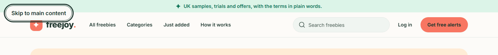
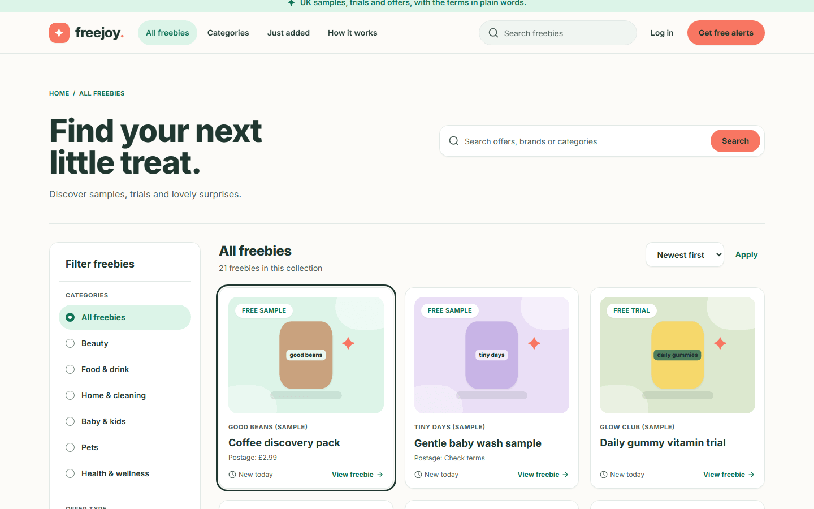

# 6. Keyboard and accessibility tips

[Back to the guide index](README.md)

Freejoy is designed to work with a keyboard, a screen reader, a phone and a zoomed-in screen. These are the tips
that matter most. They describe what the app does today; they are not a certification (the project's own
accessibility checks are described in the developer documentation).

## Step 1. Skip the menu

1. Load any Freejoy page.
2. Press **Tab** once. A box labelled **Skip to main content** appears at the top left with a thick dark outline.
3. Press **Enter** to jump straight to the page content, past the header and menu.

## Step 2. Move around with the keyboard

| Key | What it does |
| --- | --- |
| **Tab** / **Shift + Tab** | Move forwards / backwards through links, buttons and form fields |
| **Enter** | Follow a link or press a button |
| **Space** | Tick a checkbox or press a button |
| **Arrow keys** | Change the choice in a drop-down such as **Sort by** (it does not apply until you press **Apply**) |
| **Escape** | Close the phone menu or the filter drawer |

Everything in the catalogue, including every category, type and postage filter, page number and offer card, is a
normal link or form control, so it can all be reached and used without a mouse.

## Step 3. See where you are

The thing you are on always gets a clear outline. On a card, the **whole card** is outlined (not only the link
inside it), so you can tell which offer you are about to open.

Other pointers that do not rely on colour alone:

- The page you are on in the header is highlighted and marked as the current page for screen readers.
- A chosen filter shows a filled dot or a tick, as well as a coloured background.
- Offer type, postage and "card required" are written as words, never only as icons or colours.

## Step 4. Fill in forms with confidence

- Every field has a visible label.
- When the alerts form has a problem, the message is written next to the field and the first problem field is
  focused so you can fix it straight away.
- Buttons that start work (for example sending the alerts form) stay focused and say what they are doing, such as
  "Sending...", instead of disappearing.

## Step 5. Screen readers

- The page has a main region, a header, a footer and labelled navigation areas ("Main", "Quick links" on a phone,
  "Legal and about" in the footer).
- Offer pictures are illustrations. Each has a short text description, and the offer's details are always written out
  in text beside it.
- The error panel ("The freebies are not loading") is announced as an alert; a loading message is announced as a
  status.
- Long tables are not used on the public pages; offers are lists of cards.

## Step 6. Larger text and small screens

1. Increase your browser's text size or zoom in. The layout re-flows into one column rather than scrolling sideways.
2. On a phone, controls are at least about 44 pixels tall so they are easy to tap.
3. The filter drawer and the menu panel trap the keyboard focus inside them while open, and return it to the button
   that opened them when closed.

## Step 7. If a page does not work for you

The Contact page does not send messages yet (see [page 5](05-information-pages.md#step-3-contact)) and no support
address is published yet, so there is no way to report an accessibility problem from the site today. Tell the site
owner directly.
