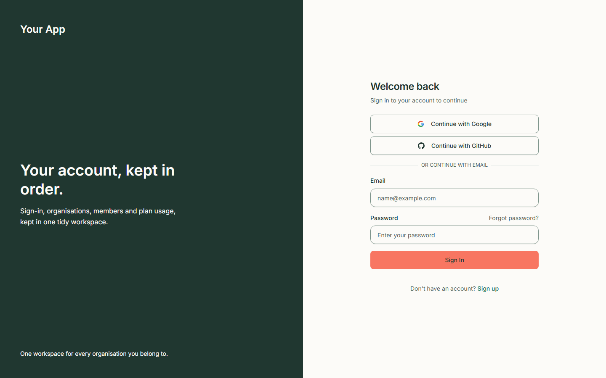
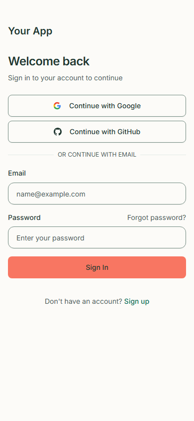
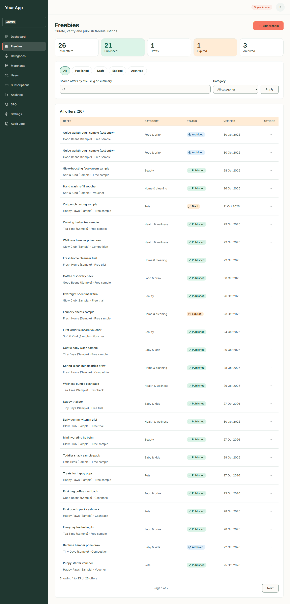
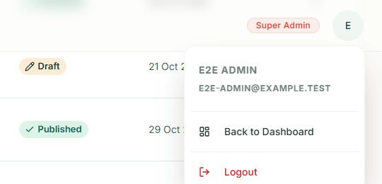
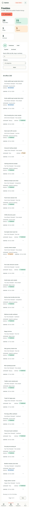
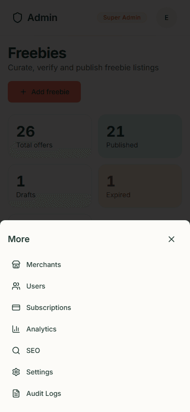
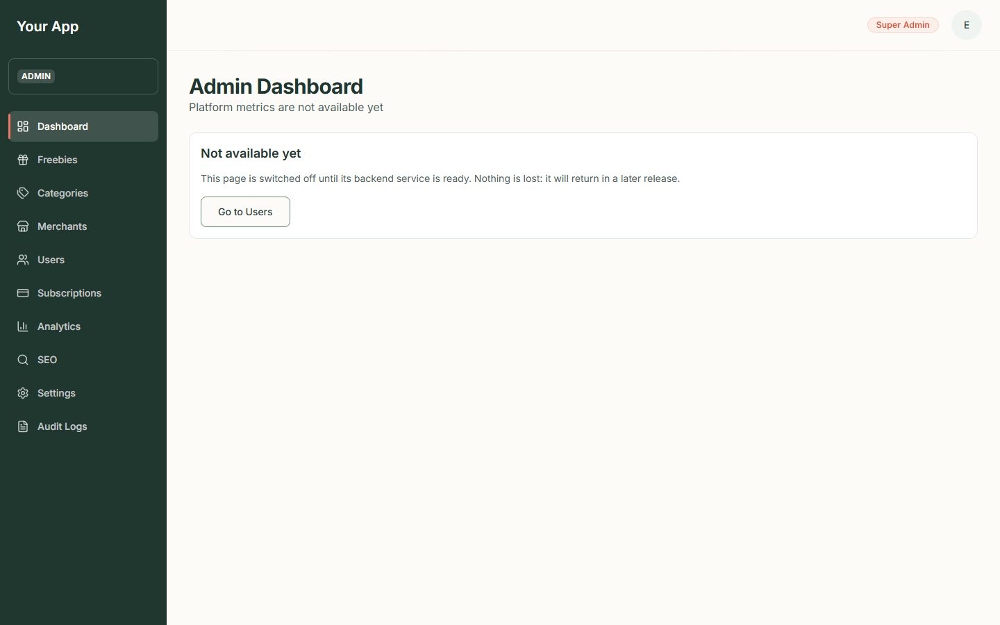
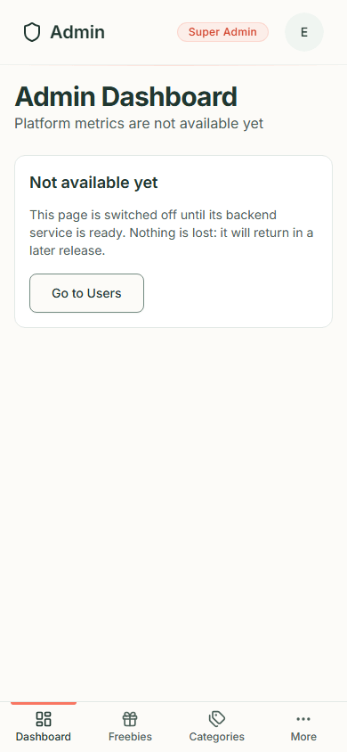

# Admin 1. Signing in and the admin shell

[Back to the guide index](README.md)

The admin area is where staff look after the catalogue (offers, categories, merchants) and see users and
reports. It is at the address `/admin` on the Freejoy site. Visitors cannot use it.

> **Screenshots in the admin guide.** The admin screens were captured through the project's test-only identity
> server on a private test database (details in the [index](README.md#how-the-screenshots-were-taken)), so the
> account in the pictures is a test account named "E2E Admin" with the role **Super Admin**. The brands, offers and
> numbers are sample data. The sign-in step itself needs a Firebase project, so it is marked as pending below.

## Who can use the admin area

You are an admin if someone has given your account an **admin role** and a list of **permissions**. Being signed
in is not enough: an ordinary account is sent to its own dashboard. Permissions decide which buttons work.
For the catalogue they are: `offers.read` (see lists), `offers.write` (create and edit offers),
`offers.publish` (verify, publish, unpublish, expire, archive), `categories.write` and `merchants.write`.
A **Super Admin** has every permission.

There is no screen for making someone an admin. An existing admin with the right permission grants it through the
backend, and the very first admin is set up directly in the database by a developer (see the developer notes in
[admin-settings.md](../developer/admin-settings.md) and [local-e2e.md](../developer/local-e2e.md)).

If you open a page and your account lacks the permission, you still see the page; when you try the action the
message **"You do not have permission to do that"** appears.

## Step 1. Sign in

Admins sign in on the same page as everyone else.

1. Go to `/login` (the **Log in** link in the public header).
2. Type your **Email** and **Password** and press **Sign In**, or use **Continue with Google** or **Continue with
   GitHub**. **Forgot password?** starts a reset.
3. If your email address is not verified yet you are sent to **Verify your email**: open the link in the email
   Firebase sent you, then sign in again.
4. Once you are in you land on your own **dashboard** (the account area), unless you were sent to the sign-in page
   from another page of the site, such as `/admin` (see Step 2): then you return to that page. If you use two-factor
   authentication, the code step comes first and the return still happens after it. Your sign-in lasts up to five days
   (a cookie called `session`).

Phone:

*Screen pending: needs the Firebase test project (owner action).* The picture above is the sign-in form only
(this build used placeholder Firebase settings). The result of a successful sign-in, the email-verification page
and the Google and GitHub pop-ups have no screenshot, because no Firebase project was available and the guide does
not use anyone's real credentials.

## Step 2. Open the admin area

1. Open the **account menu** on your dashboard (the round button with your picture or initial). If your account is an
   admin, the menu has an **Admin** link. You can also type `/admin` after the Freejoy address. There is no link to the
   admin area on the public site, and ordinary accounts do not see the **Admin** link.
2. What happens depends on who you are:

| You are... | What you see |
| --- | --- |
| Not signed in | The sign-in page, with `?redirect=/admin` added to the address. Sign in (password, Google or GitHub, and the two-factor code if you use one) and you come back to `/admin` and go through the checks in the rest of this table. Pressing **Back to sign in** on the code step and signing in again keeps the return too |
| Signed in, email not verified | The **Verify your email** page |
| Signed in as an ordinary user (not an admin) | Your own **dashboard** (an account page with Overview, Billing, Settings, Profile and Security) |
| Signed in and the system no longer accepts your session | The session is cleared and you go back to sign in |
| An admin | The admin shell, below |

The return address only works for pages of the Freejoy site. If the address in `?redirect=` is anything else (another
website, the sign-in pages themselves, or a technical address), it is ignored and you land on your dashboard. Only the
page path is remembered, not anything after a `?` such as a search or a page number. An ordinary account that returns to
`/admin` is sent on to its own dashboard, and the site does not say whether the page exists.

*Screen pending: needs the Firebase test project (owner action).* The return after sign-in has no screenshot, for
the same reason as the sign-in result above.

## Step 3. Find your way around the admin shell

On a desktop screen (900 pixels wide or more) the shell has:

1. A dark **sidebar** on the left with the heading "Your App" and the word **ADMIN**. ("Your App" is a leftover
   placeholder name from the template; it does not change with the site name.)
2. The sidebar links, in this order: **Dashboard**, **Freebies**, **Categories**, **Merchants**, **Users**,
   **Subscriptions**, **Analytics**, **SEO**, **Settings**, **Audit Logs**. The page you are on is highlighted.
3. A **header** with your **role badge** (for example "Super Admin") and a round **account button**.
4. The page itself, to the right.

### The account menu

Click the round account button (it shows your initial). The menu shows your name and email, **Back to Dashboard**
and **Logout**.

**Logout** ends your session and returns you to the sign-in page.

### On a phone

Below 900 pixels wide the sidebar is hidden.

1. The header shows **Admin** (a link to the admin home), your role badge and the account button.
2. A **tab bar** at the bottom has **Dashboard**, **Freebies**, **Categories** and **More**.
3. Tap **More** to open a panel with the rest: **Merchants**, **Users**, **Subscriptions**, **Analytics**, **SEO**,
   **Settings** and **Audit Logs**.

## Step 4. The Dashboard

**Dashboard** (`/admin`) is not built yet. It shows the heading "Admin Dashboard" with "Platform metrics are not
available yet" and a panel **Not available yet**: "This page is switched off until its backend service is ready.
Nothing is lost: it will return in a later release." The **Go to Users** button takes you to the user list.

Phone:

## Tips for every admin page

- Use **Skip to main content** (press **Tab** once) to jump past the sidebar.
- Reports can be reloaded with the **Refresh** button where one is shown.
- If a page shows a red panel with **Retry**, the backend could not be reached. Nothing is lost; try again.
- Dates in the admin area are shown in UTC (for example "30 Oct 2026, 08:57 UTC").
