# Admin 2. Offers (freebies)

[Back to the guide index](README.md)

**Freebies** in the sidebar (`/admin/offers`) is where offers are created, checked, published and retired. Nothing
reaches the public site until an admin has **verified** and **published** it. (The brands and offers in the
screenshots are sample data, and the list includes two archived "Guide walkthrough sample (test entry)" items made
while writing this guide: see the [index](README.md#the-data-in-the-screenshots-is-sample-data).)

## What the statuses mean

| Status | Colour | On the public site? | What it means |
| --- | --- | --- | --- |
| **Draft** | Orange | No (the address gives "page not found") | Being written, or taken down. Every new offer starts here |
| **Published** | Green | **Yes** | Live in the catalogue, on its own page and in search |
| **Expired** | Orange | Shows the "This offer has ended" page for 30 days, then "page not found" | The offer is over, or you ended it. It can be published again |
| **Archived** | Blue | No | Retired for good. Cannot be edited, verified or published, and there is no un-archive button |

Which actions each status allows:

| Current status | Mark verified | Publish | Unpublish | Expire | Archive |
| --- | --- | --- | --- | --- | --- |
| Draft | yes (stays Draft) | yes | - | - | yes |
| Published | yes | - | yes (goes to Draft) | yes | yes |
| Expired | yes | yes (goes to Published) | - | - | yes |
| Archived | - | - | - | - | - |

## Step 1. Open the list

1. Click **Freebies** in the sidebar (or the **Freebies** tab on a phone).
2. At the top, a strip of numbers shows **Total offers**, **Published**, **Drafts**, **Expired** and **Archived**.
   Each number is counted live, and the total is their sum.
3. Under it are the status chips, the search box and the category filter, then the table.
4. The table columns are **Offer** (title, with the brand and offer type underneath), **Category**, **Status**,
   **Verified** (the date it was last checked, or "Not verified") and **Actions**.

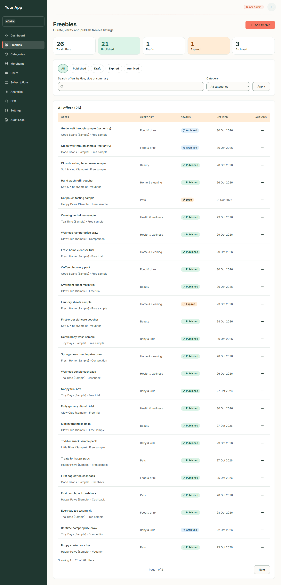

On a phone each row becomes a card and every value names its column:

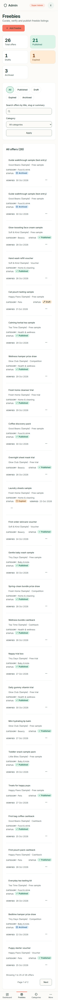

## Step 2. Search and filter

1. Click a status chip (**All**, **Published**, **Draft**, **Expired**, **Archived**) to show only that status. The
   current chip is marked as the current page.
2. To search, type in **Search offers by title, slug or summary** and press **Apply**.
3. To narrow by category, pick one in **Category** and press **Apply**.
4. The filters combine and the address updates, so you can bookmark a view. Searches are limited to 100 characters.

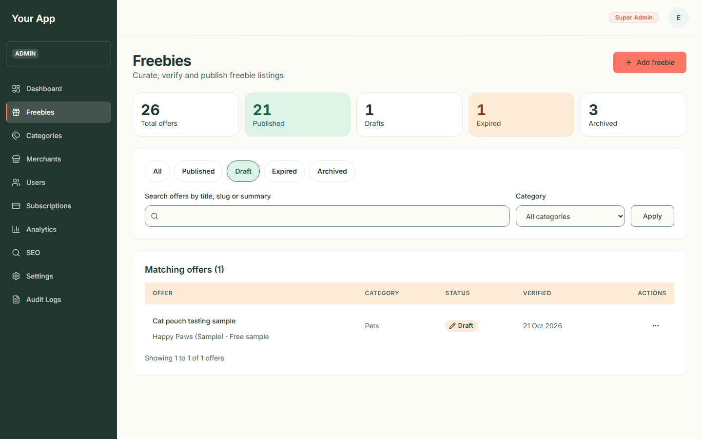

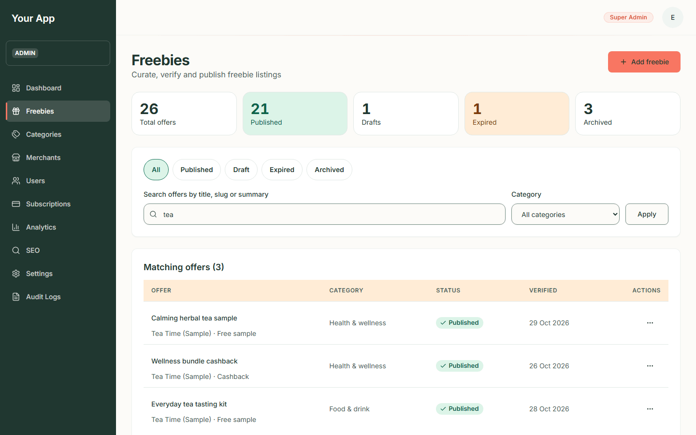

Phone:

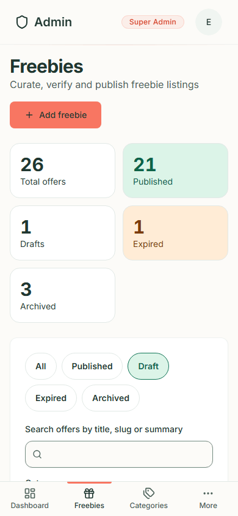

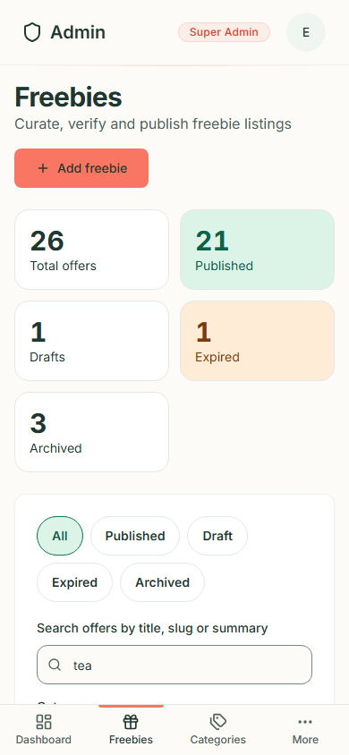

The list is paged, 25 offers at a time: a line such as "Showing 26 to 50 of 61 offers" and
**Previous** / **Next** links appear under the table.

## Step 3. Use a row's menu

1. In the **Actions** column click the three dots (named "Open menu for *offer title*").
2. The menu starts with **Edit**, then lists the steps the offer's status allows: **Mark verified**,
   **Publish** or **Unpublish**, **Expire** and **Archive** (in red).
3. **Archive** asks you to confirm first (see Step 9). The other actions happen at once and a message appears.

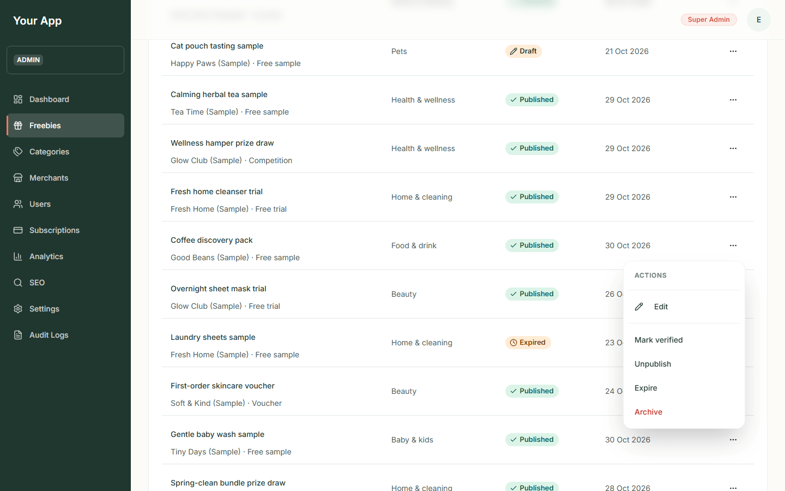

Phone:

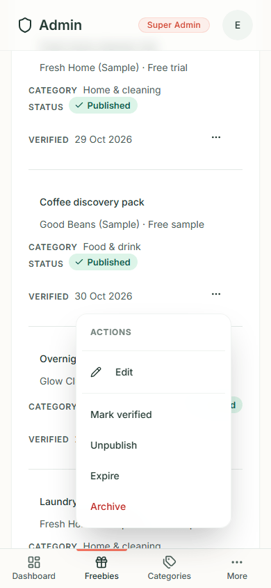

If the menu is out of date (someone else changed the offer a moment ago), the action is refused with a message and
nothing is changed.

## Step 4. Add a new offer

1. Click **Add freebie** (top right of the list). The page says "A new offer starts as a draft. Verify it, then
   publish it, to put it on the site."
2. Fill in the form, which is in sections. Fields with a red star are required.

| Section | Fields |
| --- | --- |
| **Basics** | **Title**\*, **Slug** (the web address of the page; leave blank to use the title; it cannot be changed later), **Summary**\*, **Description** (separate paragraphs with a blank line, up to 20) |
| **Category and merchant** | **Category**\*, **Merchant**\*, **Offer type**\* (Free sample, Free trial, Cashback, Voucher, Competition), **Freshness label** (None, New today, Just added, Popular, Ends soon, Limited: an editor's label, never worked out from dates), **Featured on the home page** |
| **Picture** | **Picture tint**\* (Blush, Mint, Lavender, Sky, Butter, Cream, Sage, Sand), **Picture label**\* (short text drawn on the illustration), **Picture description**\* (text for people who cannot see the picture) |
| **Terms and claiming** | **Postage**\* (Free postage, Postage costs money, Check the terms; with a **Postage cost (GBP)** box when it costs money), **Needs a payment card to claim**, **Subscription terms**, **Who can claim**\*, **Availability**\*, **Source URL** (the merchant's own page) |
| **How to claim** | **Add a step**: each step has a **Step title** and **Step detail**; steps can be removed |
| **Schedule and notes** | **Starts (UTC)**, **Ends (UTC)** (optional), **Publisher notes** (for admins only, never shown to visitors) |

3. Press **Create draft**. If something is missing, each problem is written beside its field, the first problem field
   is focused, and the button stays on the page.

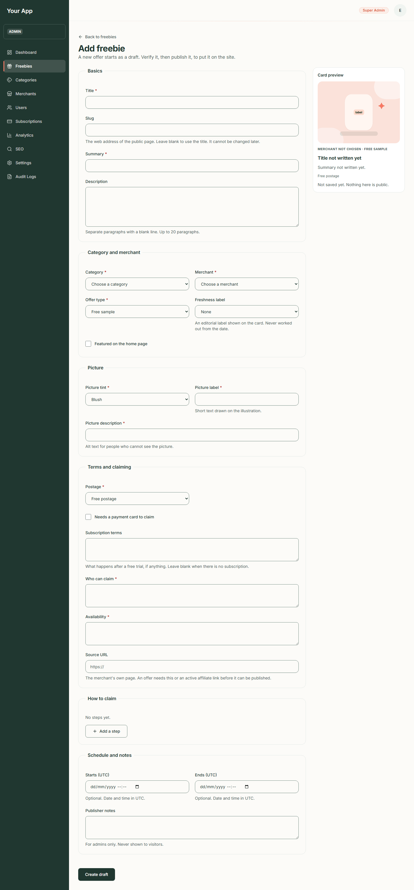

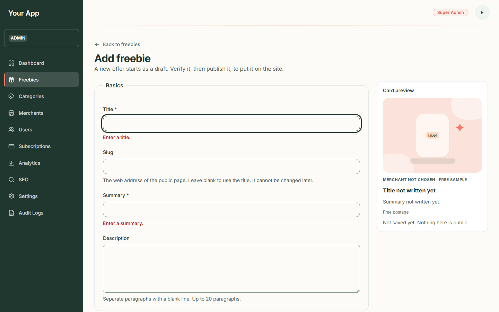

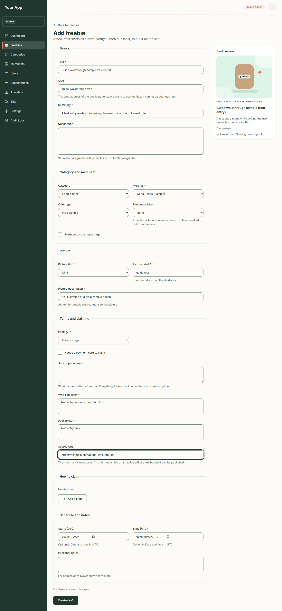

4. When it works you land on the new offer's editor page with status **Draft**.

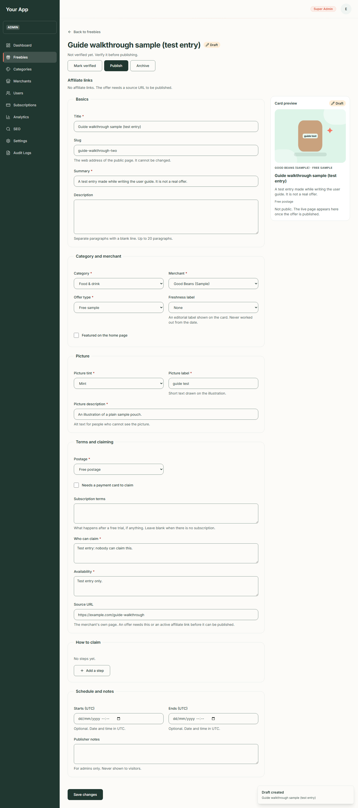

Notes:

- Times are entered in **UTC**, and the form says so. Use the **Ends (UTC)** date for offers with a closing date.
- A card preview on the right is drawn from the form as you type and is labelled "Not public".
- The **Postage** and **Needs a payment card** boxes feed the "POSTAGE" and "CARD REQUIRED" facts visitors see.
- **Affiliate links** are shown on the editor page (read only). Creating them is not possible from these screens
  yet (see "Not in the admin screens" at the end).

## Step 5. Edit an offer

1. In the list click the offer's title (or **Edit** in the row menu).
2. Change what you need. The slug and status cannot be changed here.
3. Press **Save changes**. A "Changes saved." message appears. While you have unsaved edits the form says "You have
   unsaved changes." and your browser asks before you close the tab.
4. Saving a published offer updates the public page straight away.

The status buttons at the top (Mark verified, Publish and so on) act on the **last saved** version of the offer, so
while you have unsaved edits they wait and say why. Save first.

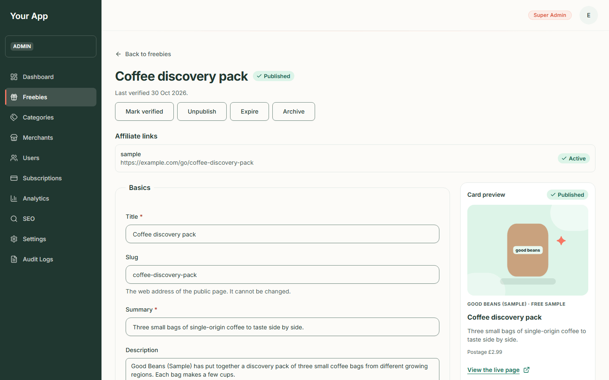

Phone:

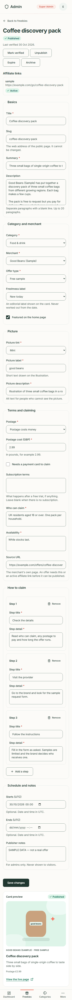

## Step 6. Verify the offer ("Last checked")

Visitors see "**Last checked** *date*" on every offer, so this step is a promise that someone looked.

1. Check the offer on the brand's own page: type of offer, postage, card needed, who can claim.
2. On the editor page press **Mark verified** (or use the row menu).
3. A message "Offer marked as verified" appears, and the line under the title reads "Last verified *today's date*."

Publishing does **not** do this for you. Verify first, every time you re-check an offer.

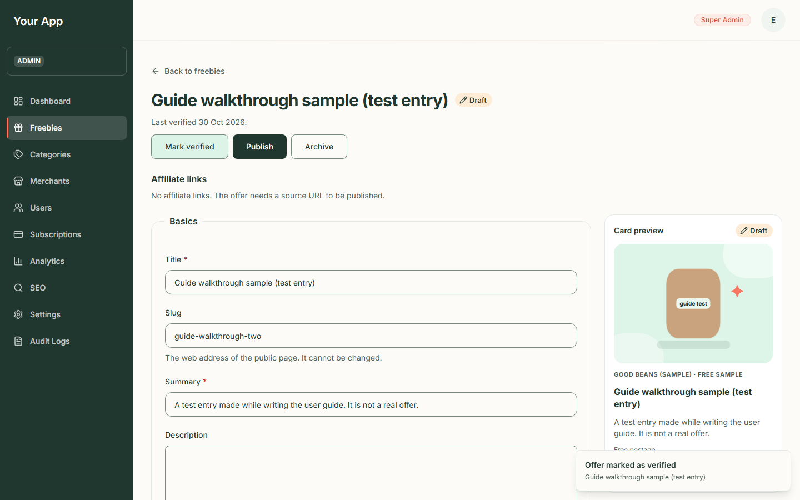

## Step 7. Publish

1. Press **Publish**.
2. Freejoy checks that: the category is **enabled**, the merchant is **active**, the offer has a **Source URL** or an
   active affiliate link, the end date is not in the past, and the offer has been **verified**.
3. If any rule fails you get a red message such as "Could not publish - This offer cannot be published yet: it has
   not been verified." and the offer stays as it was. Fix the cause and try again.
4. When it works the status turns **Published**, a message "Offer published" appears, and a link **View the live
   page (opens in a new tab)** appears in the card preview.

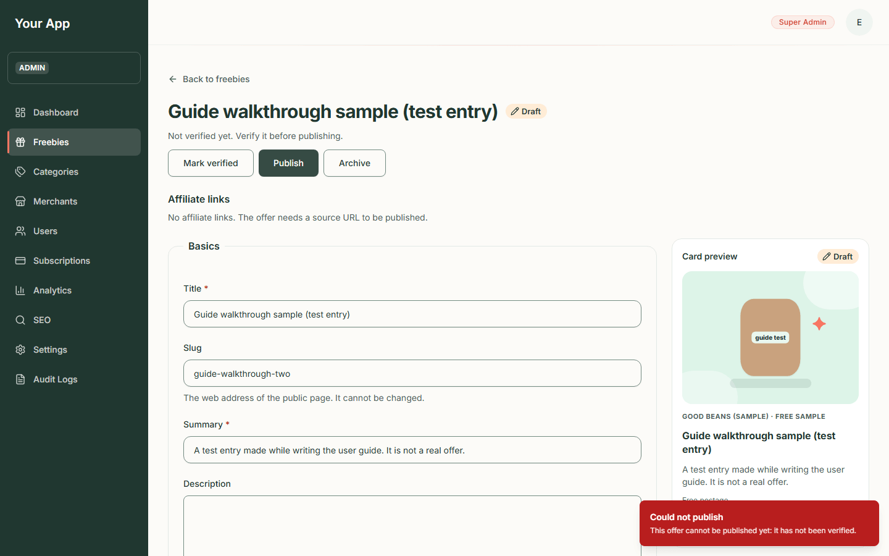

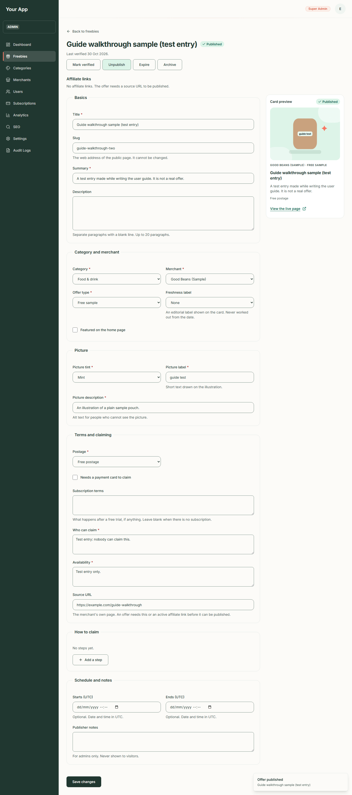

5. Open the live page to check it. This is how the offer now looks to visitors (it is the test entry made for this
   guide):

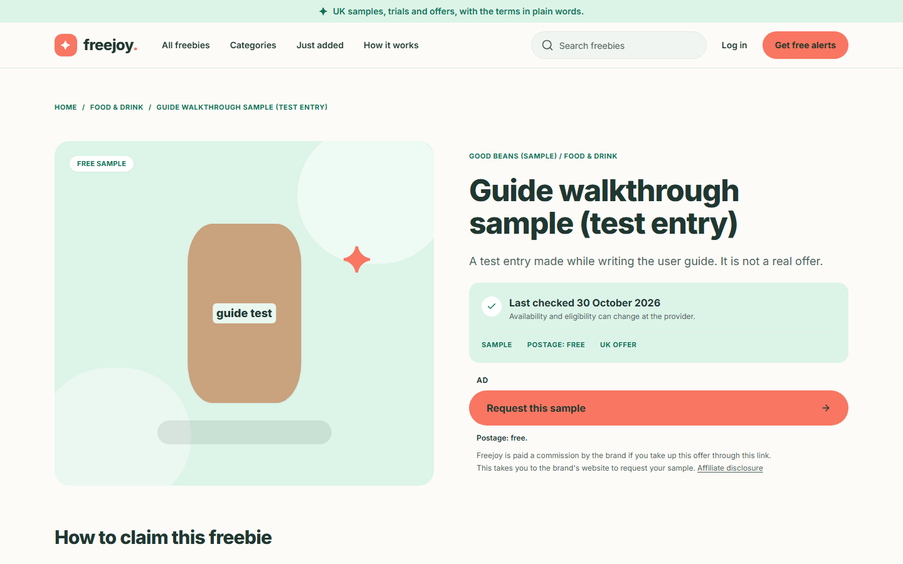

## Step 8. Unpublish or expire

- **Unpublish** takes a published offer back to **Draft**. Its public address stops working at once.
- **Expire** marks a published offer as over. Visitors see the "This offer has ended" page for 30 days, and
  claim links for it send them there. An expired offer can be **published** again after you check it.

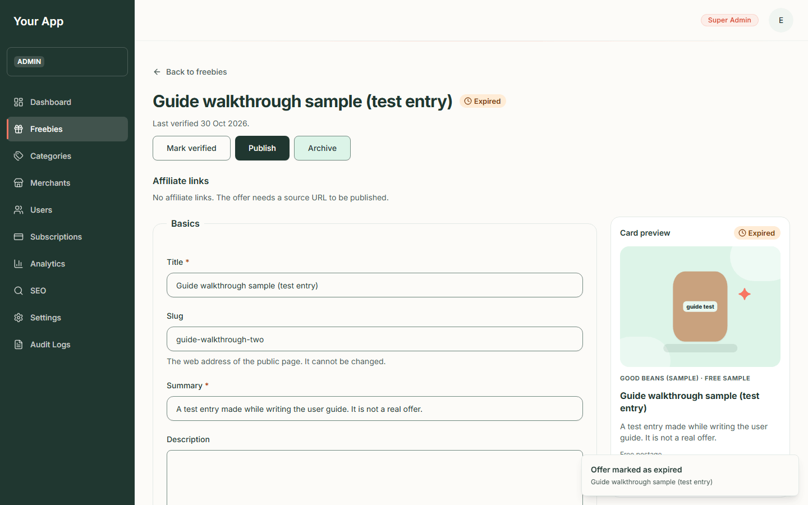

## Step 9. Archive

1. Press **Archive**.
2. A box asks "Archive this offer?" and explains that the offer "will leave the public site and can no longer be
   edited, verified or published. Archiving cannot be undone from the admin."
3. Press **Archive offer** to confirm (or **Cancel**).
4. The page now says "This offer is archived and cannot be changed."

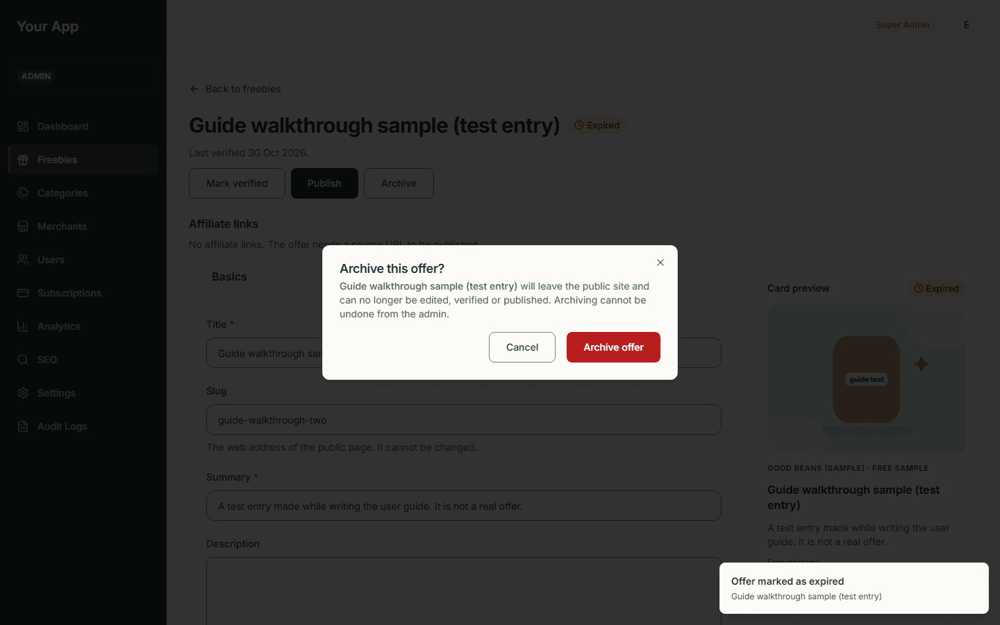

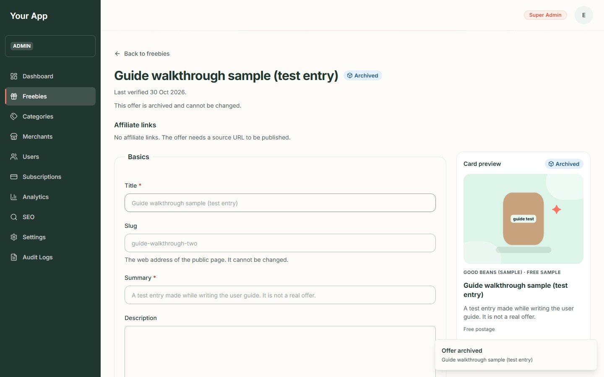

## Things to know

- Disabling a category or deactivating a merchant **does not unpublish** its offers, but visitors stop seeing them.
  The admin list can therefore show **Published** offers that the public site hides.
- An offer that has passed its end date is not unpublished automatically. Expire it yourself.
- Two admins editing at once: the last save wins.
- Every change here is written to the [audit log](admin-06-audit-logs-seo-settings.md) with who and when.

## Not in the admin screens

These exist in the backend but have no screen yet: creating or switching off **affiliate links**, un-archiving an
offer, and a "Needs review" count.
