# Admin 3. Categories and merchants

[Back to the guide index](README.md)

Every offer belongs to one **category** (such as Food & drink) and one **merchant** (the brand behind it). Both are
managed here. (The categories and merchants in the screenshots are the project's sample data: every merchant name
ends "(Sample)" and every website is a placeholder on `example.com`.)

You need the `categories.write` permission to change categories and `merchants.write` to change merchants. Anyone
who can open the admin area can look at the lists.

## Part A. Categories

### Step 1. See the categories

1. Click **Categories** in the sidebar (or the **Categories** tab on a phone).
2. The page explains: "Group freebies on the public site. A disabled category and its offers are hidden."
3. The table shows **Name** (with a one-line description), **Slug** (the web address part), **Order** (lower numbers
   come first), **Status** (**Enabled** or **Disabled**), **Updated** and **Actions** (**Edit** and a **Disable** or
   **Enable** button).

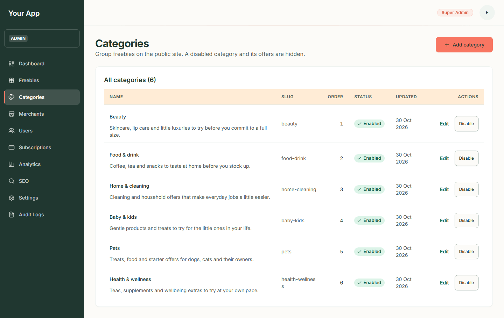

Phone:

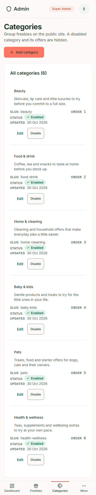

### Step 2. Add a category

1. Click **Add category**.
2. Fill in the form:
   - **Name**\*: the full name, for example "Food & drink".
   - **Slug**: the web address of the category page. Leave it blank to make one from the name. **It cannot be changed
     later.**
   - **Short name**\*: used on chips and the phone grid.
   - **Description**\*: one sentence for cards and search results.
   - **Introduction**\*: the text at the top of the category's public page.
   - **Tint**\*: one of Blush, Mint, Lavender, Sky, Butter, Cream, Sage, Sand.
   - **Sort order**\*: a number; lower comes first.
   - **Enabled (visible on the public site)**: tick it to show the category straight away.
3. Press **Create category**. Problems (a missing field, a slug that is already used) appear beside the field.

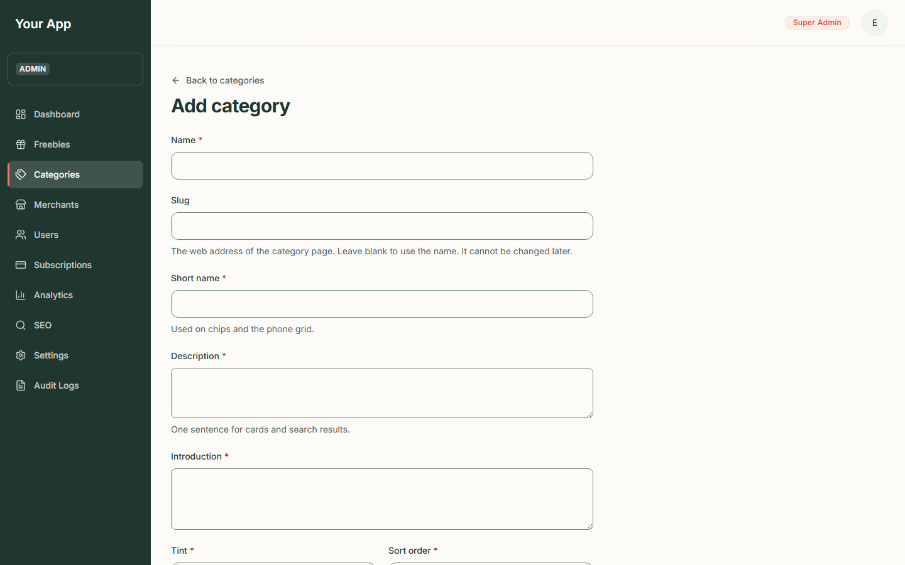

Phone:

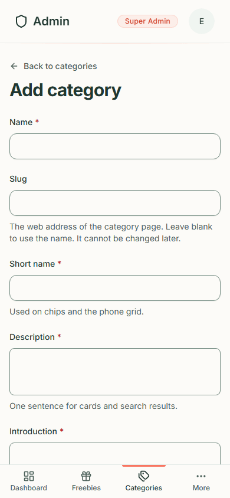

### Step 3. Edit a category

1. In the list, click **Edit** on the row.
2. Change the fields (the slug is locked: "It cannot be changed.") and press **Save changes**.

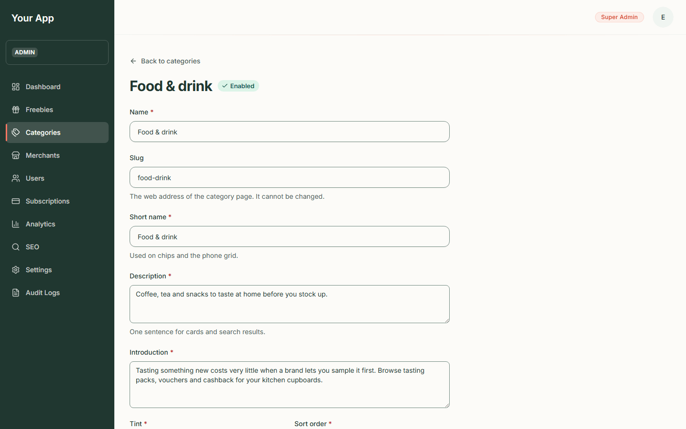

Phone:

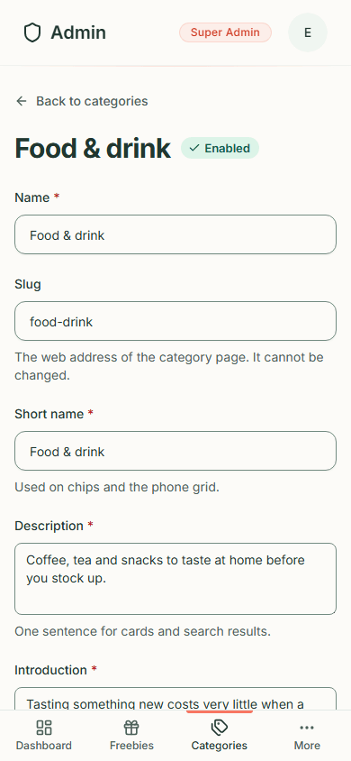

### Step 4. Disable or enable a category

1. Click **Disable** on the row. It happens at once (there is no confirmation) and a message such as "Pets disabled"
   appears. The row turns orange and the button becomes **Enable**.
2. On the public site the category page now gives "page not found", and the category's offers no longer appear in the
   catalogue, search or home page.
3. Click **Enable** to bring it back.

The offers inside a disabled category keep their status: they stay **Published** in the admin list but visitors
cannot see them. A category must be **enabled** before an offer in it can be published.

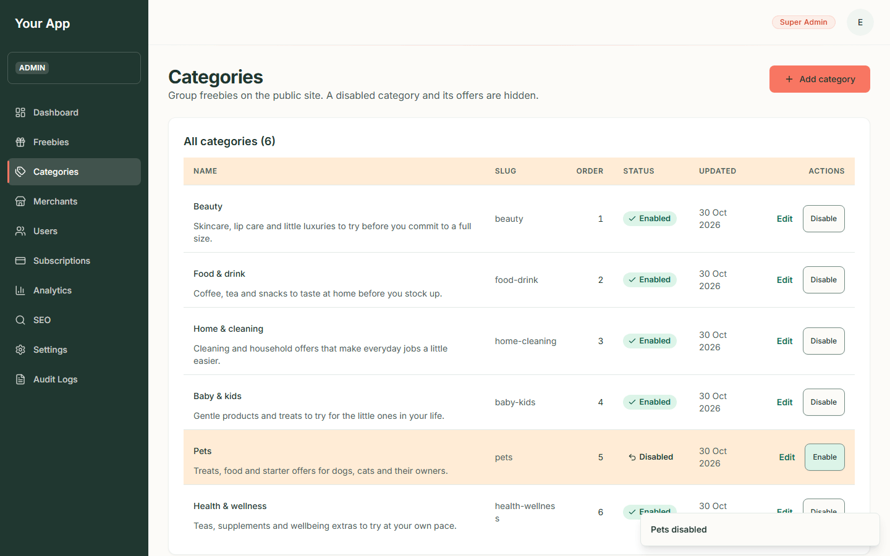

## Part B. Merchants

### Step 5. See the merchants

1. Click **Merchants** (under **More** on a phone).
2. The page explains: "The brands behind each freebie. An offer can only be published for an active merchant."
3. The table shows **Name**, **Slug**, **Website**, **Status** (**Active** or inactive), **Updated** and **Actions**
   (**Edit** and **Deactivate** or **Activate**).

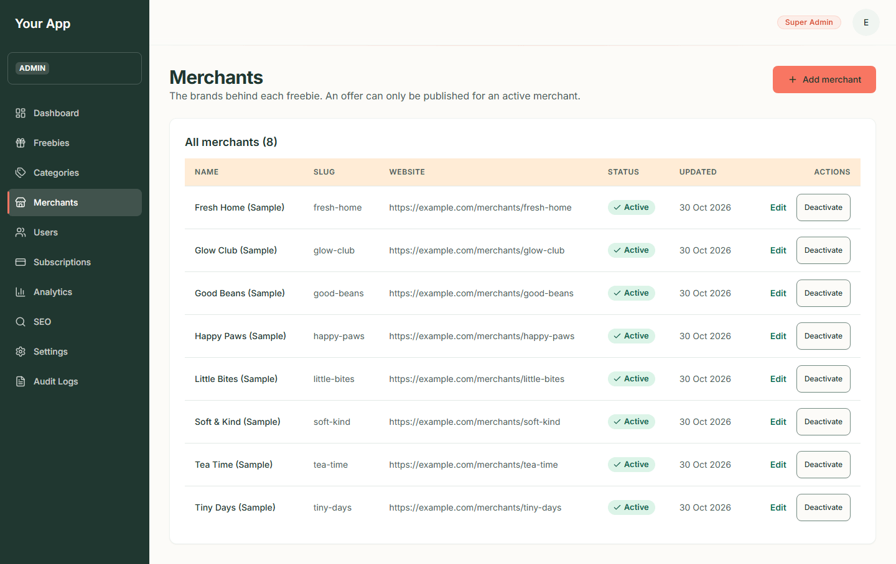

Phone:

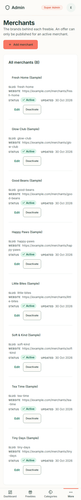

### Step 6. Add a merchant

1. Click **Add merchant**.
2. Fill in the form: **Name**\*; **Slug** (leave blank to use the name; it cannot be changed later); **Website**
   (optional, a full `https://` address); **Logo address** (optional, a full `https://` address of a logo you are
   licensed to use); and **Active (its offers can be published)**.
3. Press **Create merchant**. Web addresses must be `https` and look like normal website addresses.

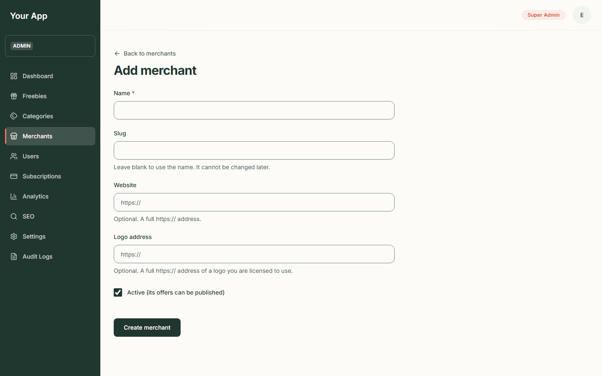

Phone:

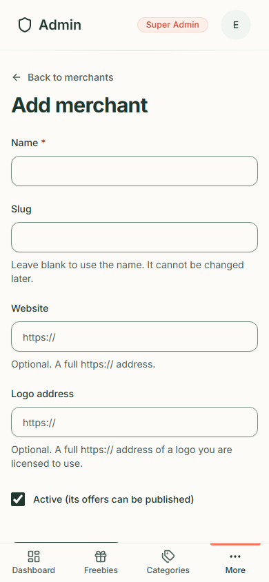

### Step 7. Edit, deactivate or activate a merchant

1. Click **Edit**, change the details and press **Save changes** (the slug is locked).
2. Click **Deactivate** to switch a merchant off. Its offers stop appearing to visitors and cannot be published
   until you press **Activate**. As with categories, there is no confirmation and a message tells you what happened.

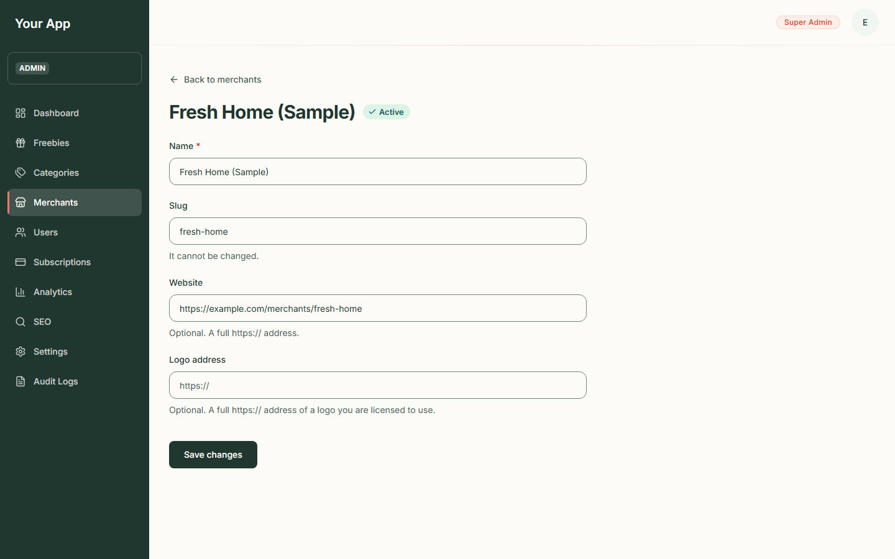

Phone:

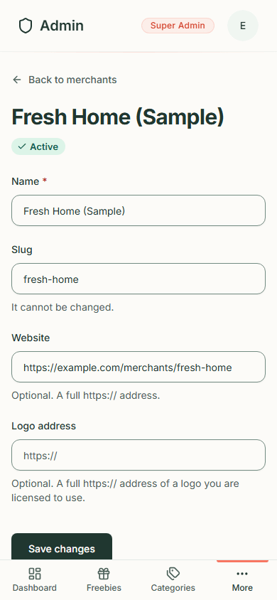

## Things to know

- Only the first 100 categories and merchants are listed and offered in the offer form. If a catalogue ever grows
  past that, the page says "Showing the first N of M".
- Disabled categories and inactive merchants are marked as such in the offer form's drop-downs, so a refused publish
  is not a surprise.
- Every change is recorded in the [audit log](admin-06-audit-logs-seo-settings.md).
- The public alerts sign-up form lists the categories the public catalogue has, so an enabled category appears there
  too and a disabled one does not.
