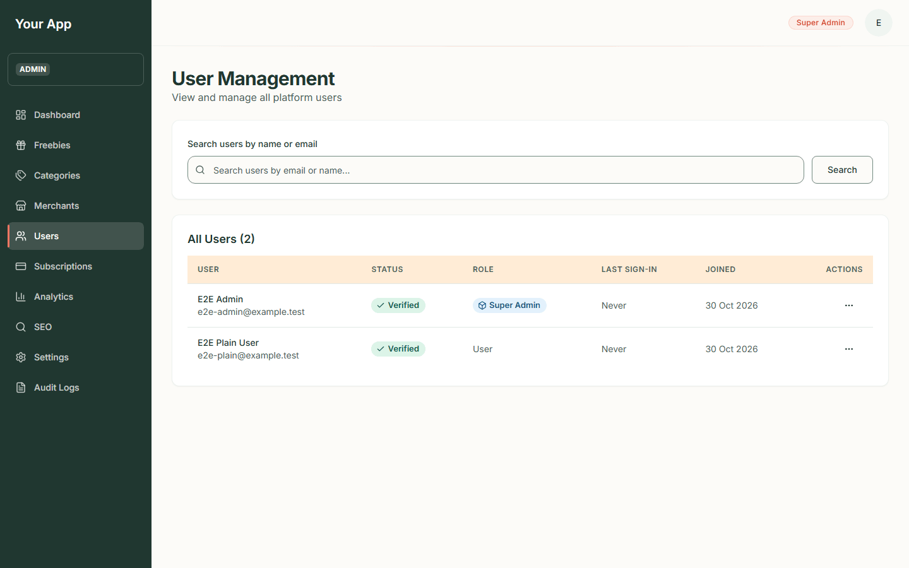
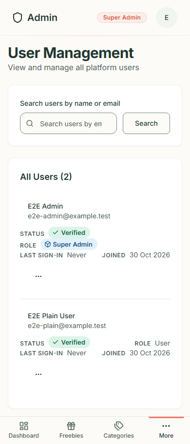
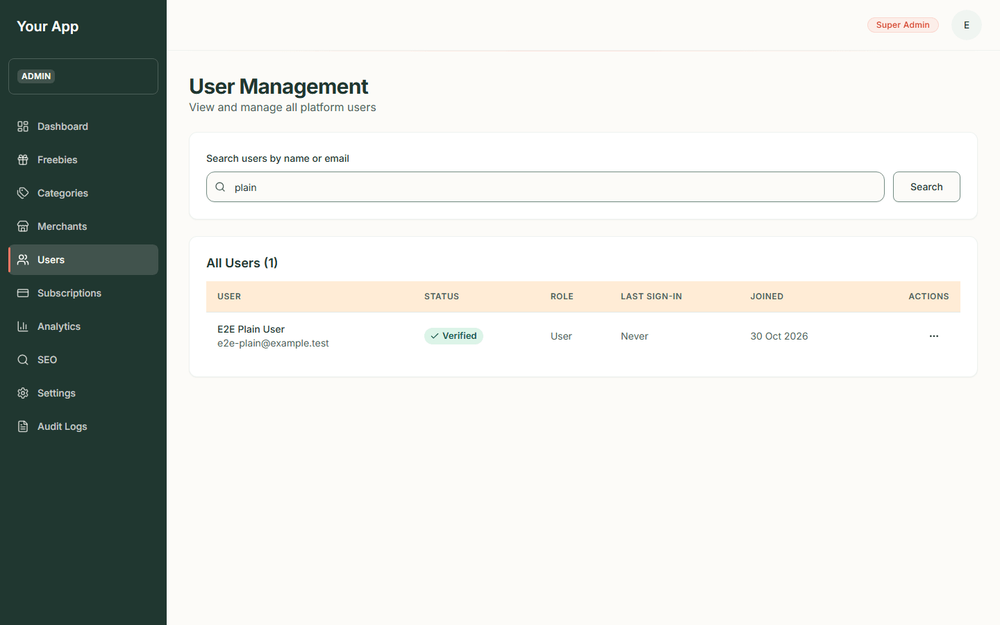
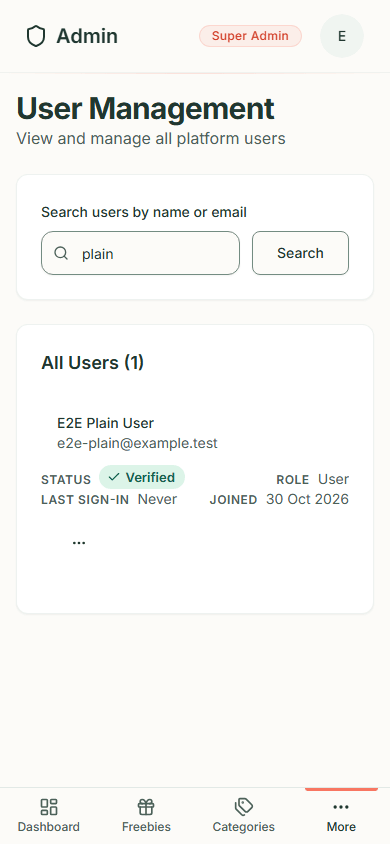
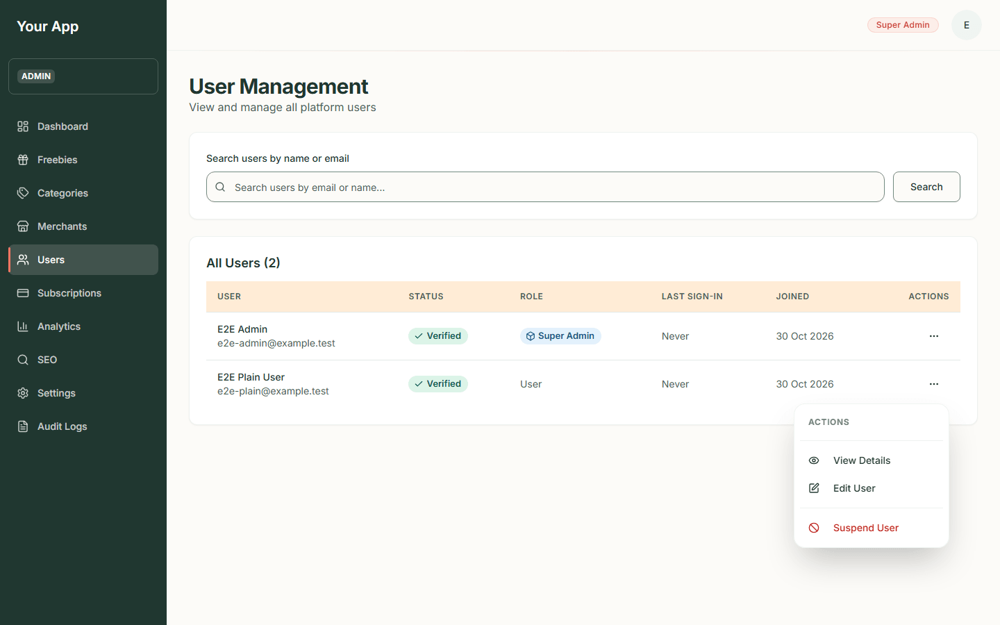
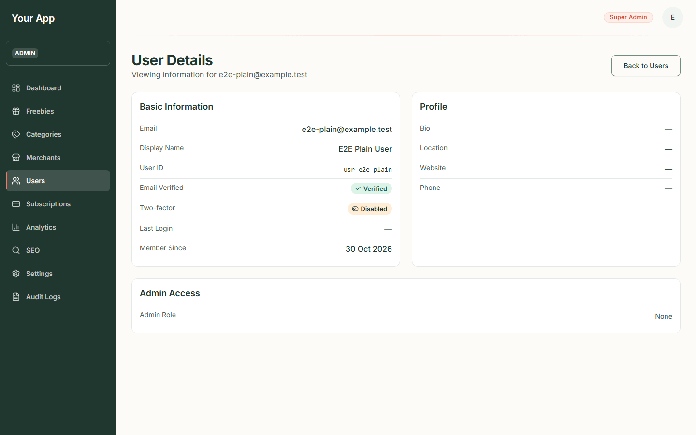
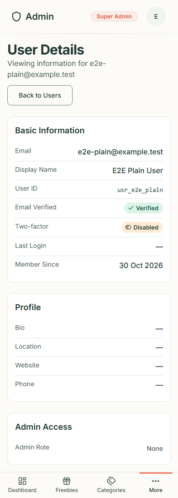
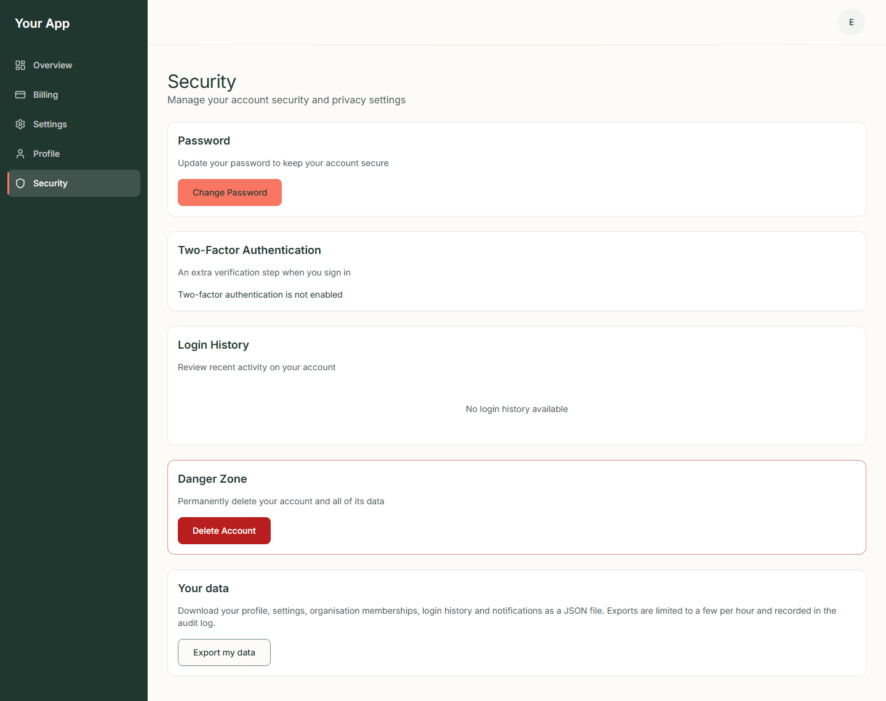
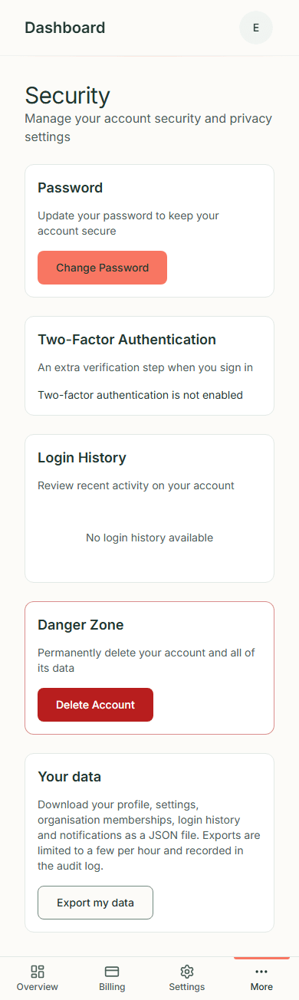

# Admin 4. Users and two-factor sign-in

[Back to the guide index](README.md)

**Users** in the sidebar lets an admin look people up. It is read-only today: you can find and view accounts, but the
screens do not yet let you edit, suspend or delete them. (The two accounts in the screenshots, "E2E Admin" and "E2E
Plain User" on `example.test` addresses, are test accounts that came with the test setup. They are not real people.)

The list needs the `users.read` permission.

## Step 1. Open the user list

1. Click **Users** (under **More** on a phone).
2. The page is headed **User Management**: "View and manage all platform users".
3. Under the search box, **All Users (*n*)** shows how many accounts there are, then a table:

| Column | What it shows |
| --- | --- |
| **User** | Display name ("Not set" if none) and email address |
| **Status** | **Verified** (green) or **Unverified** (orange): whether the person has confirmed their email |
| **Role** | The admin role as a blue badge (for example **Super Admin**), or "User" for an ordinary account |
| **Last sign-in** | The date, or **Never** |
| **Joined** | The date the account was created |
| **Actions** | A three-dot menu |

Phone:

## Step 2. Search for someone

1. Type part of a name or an email address into **Search users by name or email**.
2. Press **Search**. The heading counts the matches. If nothing matches the page says "No users match '*your
   words*'" with a **Clear** button.
3. If the list runs to more than one page, use **Previous** and **Next** at the bottom.

Phone:

> The search word travels in the page address, so an email address you type can stay in your browser history and in
> server logs. This is noted in the privacy information.

## Step 3. Open a user's details

1. Click the three dots in the **Actions** column, then **View Details**.
2. The **User Details** page shows three panels:
   - **Basic Information**: **Email**, **Display Name**, **User ID**, **Email Verified**, **Two-factor** (**Enabled**
     or **Disabled**), **Last Login** and **Member Since**.
   - **Profile**: **Bio**, **Location**, **Website** and **Phone** (a dash when not filled in).
   - **Admin Access**: the **Admin Role** (or "None") and, for admins, the list of **Permissions**.
3. **Back to Users** returns to the list.

Phone:

## Things that look like buttons but do nothing yet

The three-dot menu also shows **Edit User** and **Suspend User**. At the moment these two items **do not do
anything** (the menu closes and nothing else happens). The backend can edit profile details, ban and unban, delete
accounts and grant or remove admin roles, but there is no screen for it yet. Until there is, these actions are done
through the backend by a developer.

## Two-factor authentication (2FA)

Two-factor authentication adds a six-digit code from an authenticator app to signing in. Where it stands today:

- **Account level.** 2FA belongs to each person's own account, not to the admin area. Each person manages it on their
  own **Security** page, reached from their dashboard (`/dashboard/security`).
- **Status only.** The Security page has a **Two-Factor Authentication** panel that says either "Two-factor
  authentication is enabled" or "Two-factor authentication is not enabled" (or "Two-factor status unavailable" if it
  cannot be read).
- **Setting it up is switched off.** The page has no **Enable** button yet. The sign-in form has no box for the
  six-digit code, but the system behind it refuses to sign in an account that has 2FA enabled unless a code is sent.
  That means an account with 2FA switched on cannot sign in through the website today; the setup screen stays hidden
  until the sign-in form asks for the code. (The backend can enrol and verify codes already.)
- **Turning it off.** An account that does have 2FA enabled sees a **Disable** button. It asks for your password and a
  six-digit code from your authenticator app ("Disable Two-Factor Authentication").
- **For admins.** An admin can see whether another user has 2FA enabled on that user's **User Details** page. Admins
  cannot switch another person's 2FA on or off from the screens.

Phone:

*Screen pending: needs the Firebase test project (owner action).* There are no screenshots of the **Disable
Two-Factor Authentication** dialog or of changing a password, because both need a real Firebase sign-in
(they re-check your password) and an account with 2FA turned on.

The Security page also holds **Change Password**, **Login History**, **Export my data** and **Delete Account**. They
are account features for the signed-in person and are not covered further in this guide. The site name at the top of
the sidebar is the configured one; screenshots taken earlier still read "Your App".
