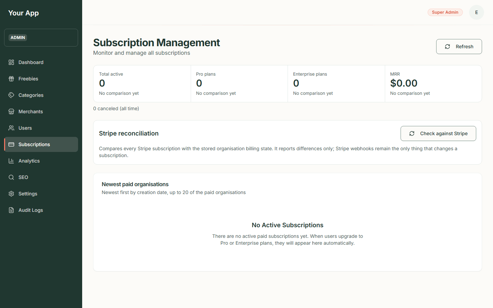
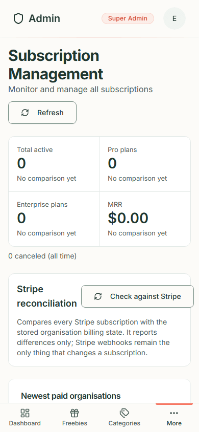
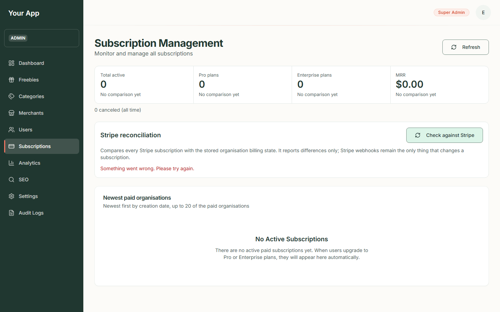
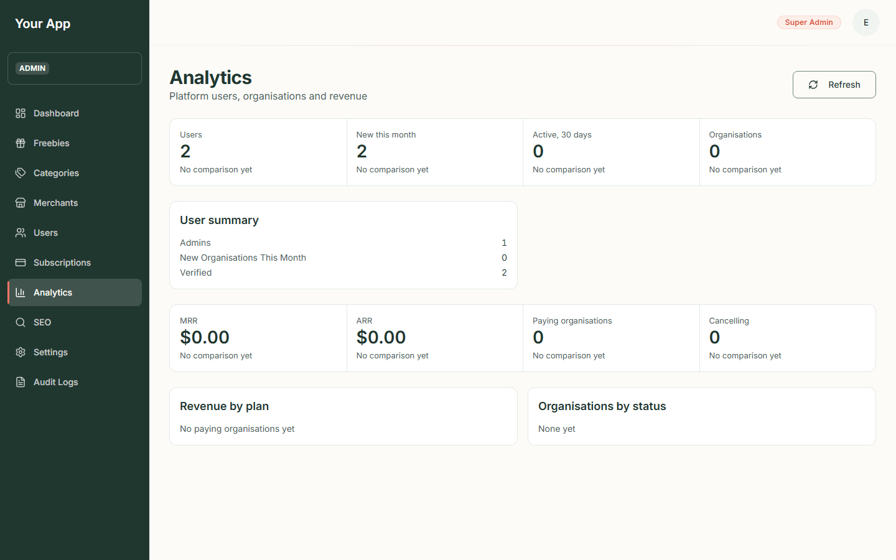
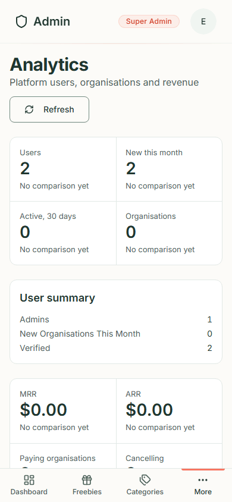

# Admin 5. Subscriptions and analytics

[Back to the guide index](README.md)

These two pages report on **accounts and paid plans**. They belong to the optional **Stripe Billing** module that
Freejoy inherited from its template: paid plans are held by an *organisation* (the team an account belongs to), and
Stripe takes the payments. Freejoy's freebies site itself is free to visitors and does not use these pages.

> **What the screenshots show.** They come from an almost empty test database: two test accounts, no organisations,
> no paying customers and no Stripe account. So every figure is zero or tiny. They show the layout, not real
> results. Anything that needs a live Stripe account is marked **Screen pending**.

Reading these pages needs the `subscriptions.read` and `users.read` permissions. The currency symbol on money
figures comes from the platform's currency setting, which defaults to British pounds (so amounts show `£`). If the
setting names another currency, amounts show that currency. The screenshots on this page were taken before the default
changed and still show `$`.

## Part A. Subscriptions

### Step 1. Open the page

1. Click **Subscriptions** (under **More** on a phone).
2. The page is headed **Subscription Management**: "Monitor and manage all subscriptions". Use **Refresh** at the top
   right to reload the numbers.

### Step 2. Read the numbers

1. A row of four figures: **Total active** (Pro plus Enterprise), **Pro plans**, **Enterprise plans** and **MRR**.
   MRR is *monthly recurring revenue*: what paying organisations are billed at list price, per month. If it cannot
   be worked out the box says **Revenue unavailable** and the rest of the page still works.
2. Under them, a line such as "0 canceled (all time)". When some paying organisations could not be priced it adds
   "Some paying organisations could not be priced, so MRR is a minimum".

Phone:

### Step 3. Compare with Stripe

The **Stripe reconciliation** panel has a **Check against Stripe** button.

1. Press it. It reads every subscription in Stripe and compares it with what Freejoy has stored.
2. A report appears: how many subscriptions were read, how many are in sync and how many differ, with one line for
   each difference ("No matching organisation", "Different subscription", "Status differs", "Plan differs",
   "Cancellation flag differs", "Not found in Stripe").
3. The check **only reports**. It never changes a subscription: only Stripe's own messages (webhooks) do that.
4. You can run it a few times a minute; the system limits it to three runs a minute per admin.

*Screen pending: needs a Stripe test account (owner action).* There is no screenshot of a successful report, because no
Stripe account was connected. Without one, pressing the button shows "Something went wrong. Please try again." under
the panel's description, as here:

### Step 4. Newest paid organisations

The table lists up to 20 of the newest paid organisations with **Organisation**, **Slug**, **Plan**, **Status** and
**Renewal Date**. The table is read-only: it has no buttons or menus. With none it says **No Active Subscriptions**:
"There are no active paid subscriptions yet. When users upgrade to Pro or Enterprise plans, they will appear here automatically."

Managing a subscription (cancelling it, refunding a payment, granting or revoking a plan) has no screen yet. The
backend can do these, but a developer does them there for now. An earlier version of this page showed a **Manage**
button on each row that did nothing; it has been removed.

## Part B. Analytics

### Step 5. Open the page

1. Click **Analytics** (under **More** on a phone). It is headed "Analytics: Platform users, organisations and
   revenue". Use **Refresh** to reload.

### Step 6. Read it

1. **Users**, **New this month**, **Active, 30 days** and **Organisations**: counts of accounts and teams. "Active" means
   people who signed in during the last 30 days.
2. **User summary**: how many users are **Verified**, how many are **Admins**, and how many **New organisations this
   month**.
3. **MRR**, **ARR** (annual recurring revenue), **Paying organisations** and **Cancelling** (paid plans that end at the
   end of the current period).
4. **Revenue by plan** (each plan, its organisations and its monthly amount) and **Organisations by status**.
5. If a section fails to load, a red box with **Retry** appears in its place and the other section still shows.

Phone:

Figures are computed from Freejoy's own records and cached prices; they are **list-price** figures (no coupons or tax).
Trial plans and plans an admin granted for free are not counted as revenue.

There is **no visitor analytics** page: Freejoy deliberately runs no analytics scripts on the public site.
