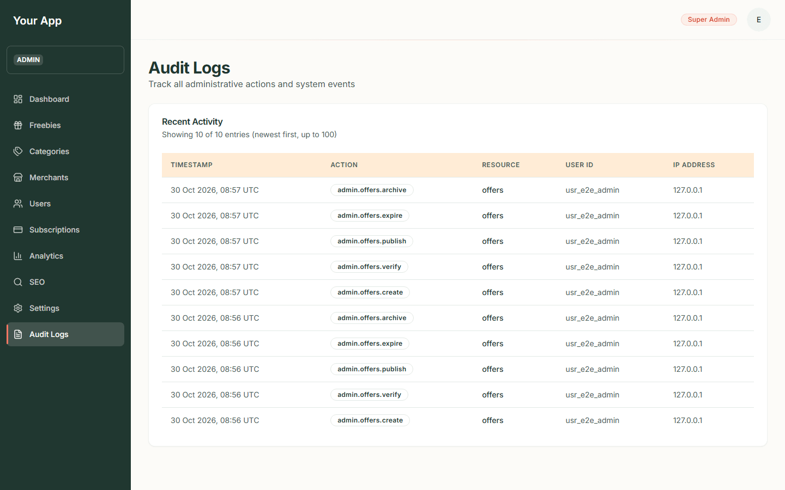
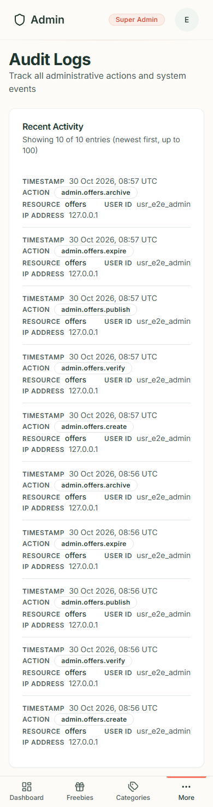
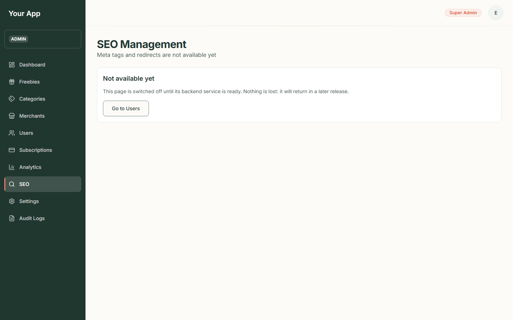
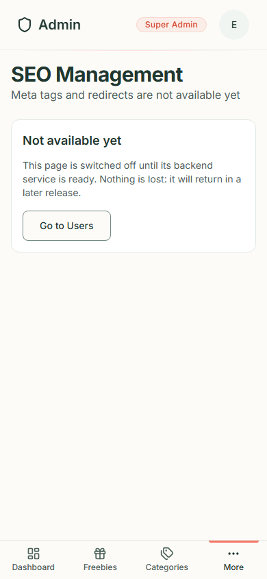
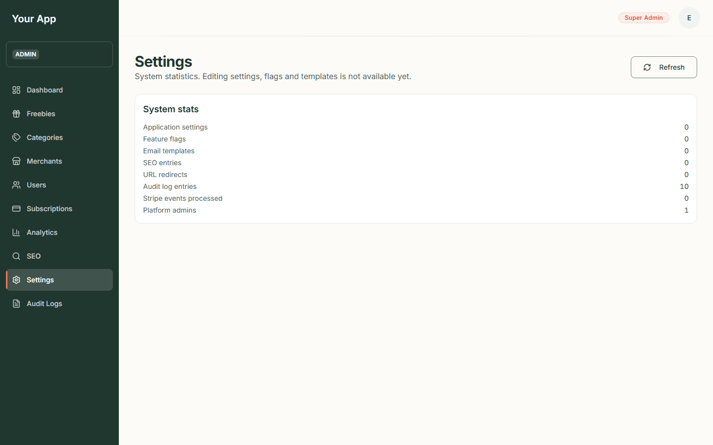
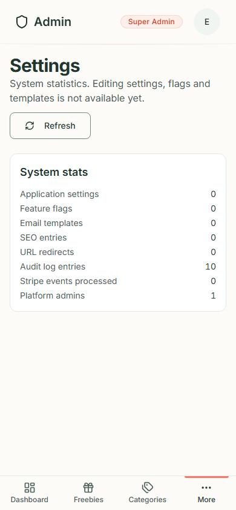

# Admin 6. Audit logs, SEO and settings

[Back to the guide index](README.md)

## Part A. Audit logs

The audit log is the record of **who changed what, and when**. Every admin change and every organisation or billing
change adds one line. Use it to answer "who unpublished that offer?" or "when was this category switched off?".

Reading it needs the `audit.read` permission (a Super Admin has it).

### Step 1. Open the log

1. Click **Audit Logs** (under **More** on a phone).
2. The page says "Track all administrative actions and system events", then a card **Recent Activity** with a line
   such as "Showing 10 of 10 entries (newest first, up to 100)".
3. The table has these columns:

| Column | What it shows |
| --- | --- |
| **Timestamp** | Date and time in UTC, for example "30 Oct 2026, 08:57 UTC" |
| **Action** | A short code in a grey outline: `admin.offers.create`, `admin.offers.verify`, `admin.offers.publish`, `admin.offers.unpublish`, `admin.offers.expire`, `admin.offers.archive`, and similar for categories, merchants, users and billing |
| **Resource** | What kind of thing it was ("offers") |
| **User ID** | The id of the admin who did it |
| **IP Address** | Where the request came from |

Phone:

In the screenshot, the ten lines are the real record of the two test offers created while writing this guide (create,
verify, publish, expire and archive for each), made by the test admin account from the local computer.

### Step 2. What is recorded, and what is not

- **Recorded**: creating, editing and every status change of an offer ("verify", "publish", "unpublish", "expire",
  "archive"), affiliate link changes, category and merchant changes (create, edit, enable/disable, activate/deactivate),
  admin changes to users and admin roles, subscription grants/cancellations/refunds, organisation and billing
  changes, and a person's own **Export my data** download.
- **Not recorded**: a refused action (for example the "could not publish" in [Admin 2](admin-02-offers.md)), simply
  looking at a page, signing in, and changes to a person's own profile, settings or two-factor.
- The log keeps *which* fields changed, not secrets: passwords, tokens and card details are never stored in it.

### Limits of the screen

The page shows the **newest 100 entries only** and has no search, filters, date range or "next page" buttons yet. The
backend can filter by user, action, organisation and date, but older entries cannot be reached from this screen
today. Ask a developer to query the backend if you need an older record.

## Part B. SEO

**SEO** in the sidebar is switched off. The page is headed "SEO Management" with "Meta tags and redirects are not
available yet" and a panel **Not available yet**: "This page is switched off until its backend service is ready.
Nothing is lost: it will return in a later release." The **Go to Users** button leaves the page.

Search-engine behaviour of the public site (which pages are indexed, the sitemap, the page titles) is set by the
site's code today, not from this screen.

Phone:

## Part C. Settings

**Settings** shows **statistics only**. The page says "System statistics. Editing settings, flags and templates is
not available yet." Under **System stats** it lists how many of each of these exist: **Application settings**,
**Feature flags**, **Email templates**, **SEO entries**, **URL redirects**, **Audit log entries**, **Stripe events
processed** and **Platform admins**. Use **Refresh** to reload.

You cannot change the site name, currency, language, theme or feature flags from this page. (Developer notes in
[admin-settings.md](../developer/admin-settings.md) describe editable General, Theme and Feature flag tabs. Those are
not what the page does today.)

Phone:

## When a page cannot load

Each of these pages shows a red box with a short message and a **Retry** button if the system behind it is not
reachable ("Something went wrong. Please try again." is typical). Nothing has been lost; try again, and tell a
developer if it keeps happening.
